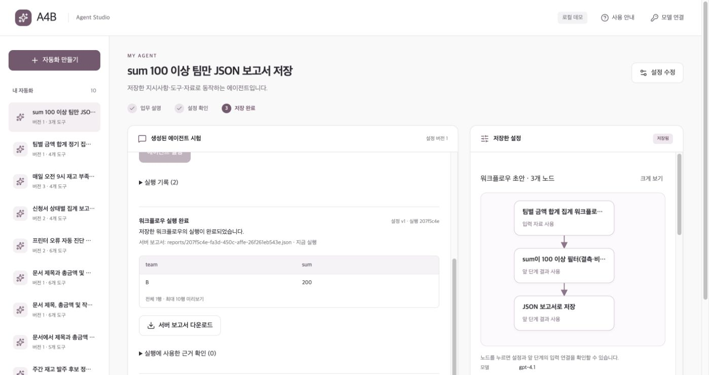
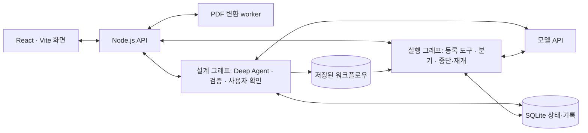

<div align="center">

# A4B

### 자연어 기반 AI 에이전트 업무 자동화 플랫폼

업무 설명을 실행 가능한 워크플로우로 연결합니다.

[진행·다음 작업](#개발-진행과-다음-작업) · [빠른 시작](#빠른-시작) · [사용 예시](#사용-예시) · [구조](#시스템-구조) · [검증과 한계](#검증과-한계) · [프로젝트 문서](#프로젝트-문서)

</div>

## 프로젝트 소개

A4B는 **업무 조건을 대화로 구체화하고, 처리 절차를 설계·저장·실행하는 플랫폼**입니다.

반복 업무를 맡길 때마다 대상과 처리 기준을 다시 설명하고, 필요한 도구와 실행 순서를 맞춰야 합니다. 조건이 달라지면 기존 설정도 다시 확인해야 합니다. A4B는 이 과정을 대화와 저장 가능한 워크플로우로 연결해, 확정한 업무 절차를 재사용할 수 있도록 지원합니다.

Deep Agents가 부족한 조건을 질문하고 도구·단계·설정을 구성합니다. 사용자는 생성된 흐름을 확인하고 저장한 뒤 실제 자료로 실행합니다. 이후 조건이 바뀌면 기존 흐름을 바탕으로 수정할 수 있습니다.


> 문서 확인 기준: 2026-10-23, main [`134895b`](https://github.com/20260528-skn-family-ai-33/SKN33-Final-5Team/commit/134895b62e3235e1ed904a2d26b8f93faf235b9d). 파서·Qwen 통합은 [PR #8](https://github.com/20260528-skn-family-ai-33/SKN33-Final-5Team/pull/8)로 병합됐습니다. 코드 연결 여부와 실제 모델의 업무 정확도는 구분합니다.

## 개발 진행과 다음 작업

기록 기준: **2026-11-01, 한국 시간**. 다음 작업은 **2026-11-02 오전에 이어서 확인**합니다. 아래는 현재 확인한 상태와 후속 계획이며, 미완료 항목을 구현 완료로 해석하지 않습니다.

### 현재 진행 상태

| 항목 | 확인한 상태 | 남은 확인 |
| --- | --- | --- |
| Windows Docker 실행 | `a4b-agent-studio:local` 이미지 약 4.24GB, 앱 컨테이너 실행 확인 | 다른 팀원 PC에서 같은 구성 재현 |
| 앱 실행 환경 | 프론트·Node API·핵심 Python·일반 문서 읽기 환경이 이미지에 포함 | OS·CPU 구조별 설치·실행 호환성 |
| OCR | 컨테이너 안 PaddlePaddle 3.2.2·PaddleOCR 3.7.0·PaddleX 3.7.2와 모델 3종 존재 확인. CPU 처리. 영수증 사진 약 760자 추출(18.7초) | 파일 종류별 정확도·처리 시간, Mac에서 실행 |
| 나머지 파서 엔진 | 별도 시험 컨테이너에서만 동작 확인, **이미지에는 아직 미포함**(아래 표) | Dockerfile 통합 후 형식별 업로드 확인 |
| Qwen 연결 | PC의 Ollama에 연결하며 `qwen3:8b-q4_K_M` 준비 상태 `ready` 확인 | 팀원별 같은 모델·설정과 컨테이너→Ollama 연결 |
| 자료 보관 | Docker 영구 볼륨에 DB·원본·결과 저장 | 백업·복구 시험, 사용자별 자료 격리 |
| 영수증 업무 | Docker에서 업로드 → 항목 질문 → 설계 → 저장 → 실행 → CSV 생성까지 완주(상품 6줄 모두 추출, 4줄 정확) | 숫자 칸 짝짓기 정확도, 날짜·상호·합계 같은 단일 항목과 함께 뽑기 |
| 예약 실행 | 관리 표 파일 한 개를 자료원으로 사용하는 일간·주간 예약 기반 있음 | 사용자별 폴더를 자료원으로 지정하는 예약 기능 |
| 서버 배포 | Dockerfile·Compose 구성 있음 | Linux GPU 서버 설치, 사내 접속·인증·권한·복구 검증 |

OCR 성공은 정리 파일 생성 성공과 구분합니다. 영수증처럼 문서·사진을 표로 정리하는 요청은 Qwen 8B가 도구를 잘못 연결하는 일이 반복되어(`read_document → write_result` 등), 현재는 **코드가 고정 흐름을 만듭니다**: 첨부 문서 + "엑셀·표·CSV" 요청이면 모델 없이 "어떤 항목을 한 줄씩 뽑을까요?"를 묻고, 답한 항목으로 `read_document → extract_information(rows) → export_result(csv)`를 구성합니다([document_rows_template.py](Backend/agent_builder/design/document_rows_template.py), `A4B_DOCUMENT_ROWS_TEMPLATE=off`로 끔). 결과 CSV는 엑셀에서 바로 열리며 `.xlsx` 생성은 아직 지원하지 않습니다. 추출 결과의 `verified`는 "원문에 있는 값"이라는 뜻이지 "올바른 칸"이라는 뜻이 아닙니다. 영수증에서 틀린 2줄은 OCR이 위에서 아래로 읽어 칸 구조가 사라진 탓이며, OCR 글자 좌표로 같은 줄을 묶는 후처리가 다음 개선 후보입니다. 자세한 기록은 [재구성 보고서 11절](REBUILD_REPORT.md#11-docker-일괄-실행--2026-11-01)에 있습니다.

**파서 엔진 시험 결과**(2026-11-01, Windows Docker, 각 엔진을 별도 시험 컨테이너에서 CPU로 실행. 이미지 통합 전)

| 엔진 | 쓰이는 곳(라우터) | 버전·설치 | 결과 | 크기 |
| --- | --- | --- | --- | --- |
| PaddleOCR | 사진 글자 | paddlepaddle 3.2.2(3.3.1은 CPU 오류) | **이미지에 포함**, 영수증 18.7초 | 모델 145MB |
| MinerU | PDF 1차 | `mineru==4.0.12`, llama.cpp CPU | 2쪽 PDF 33초, 영수증 95초 | 패키지 0.8GB + 모델 1.4GB |
| Docling | PDF 2차·DOCX/PPTX·사진 속 표 | `docling==2.133.0`, torch 2.14.1 CPU(`--index-url https://download.pytorch.org/whl/cpu`) | 글자 PDF 15.8초, 영수증 126초(표 1개 인식, EasyOCR 한글 품질은 Paddle보다 낮음) | 패키지 2.0GB + 모델 0.8GB |
| LibreOffice | DOC/PPT/XLS 변환 | Debian `libreoffice-*-nogui`, `fonts-nanum` | XLS→XLSX 변환 확인 | 약 234MB |
| rhwp | HWP/HWPX → PDF | v0.8.7. crates.io에 없음, GitHub 배포 바이너리는 GLIBC 2.39가 필요해 Debian 12 이미지에서 실행 불가 → 소스 빌드 필요(Rust 1.93.1) | 소스 빌드 진행 중 확인 못 함(확인 명령 오류) | — |

엔진을 모두 넣으면 이미지는 약 9~10GB로 예상합니다. 시험 중 세 엔진을 동시에 빌드하다 PC 메모리(16GB)가 부족해 Docker가 멈춘 적이 있으니, 빌드는 한 번에 하나씩 진행합니다.

### 처음 시작하는 팀원

**1단계 — 실행해 보기(약 1시간, 대부분 다운로드)**

1. Docker Desktop과 Ollama를 설치합니다. Windows는 Docker 설치 전에 관리자 PowerShell에서 `wsl --install --no-distribution` 후 재부팅이 필요할 수 있습니다. 메모리 16GB 이상, 디스크 여유 30GB 이상을 권장합니다.
2. 저장소를 받습니다.

   ```bash
   git clone https://github.com/tender0602/final_test.git
   cd final_test
   ```

3. Ollama 설정과 Qwen 모델 2개(약 8.5GB)를 준비합니다. 문맥 16384·KV 캐시 q8_0·모델 상주 설정이 함께 들어갑니다.

   ```powershell
   powershell -ExecutionPolicy Bypass -File scripts\prepare-ollama.ps1
   ```

   macOS는 `sh scripts/prepare-ollama.sh`입니다.
4. `docker compose up -d`로 실행하고 [http://127.0.0.1:3030](http://127.0.0.1:3030)에 접속합니다. 첫 빌드는 이미지 다운로드·설치로 10~30분 걸립니다.
5. 확인 순서: CSV 업로드 → "지역별 매출 합계를 CSV로 저장해줘" 설계 → 영수증 사진 업로드 → "엑셀파일로 정리해줘" → 항목 답변(예: `상품명, 단가, 수량, 금액`) → 저장 → 실행 → CSV 확인. 각 단계 시간과 오류를 기록해 공유합니다.

**2단계 — 코드 읽기 순서**

| 순서 | 위치 | 보는 이유 |
| --- | --- | --- |
| 1 | [REBUILD_REPORT.md](REBUILD_REPORT.md) | 폴더 재구성 이유·검증 결과·알려진 문제(1~11절) |
| 2 | [REBUILD_FILE_MAP.md](REBUILD_FILE_MAP.md) | 원본 저장소(SKN33-Final-5Team) 파일이 어디로 옮겨졌는지 |
| 3 | `Backend/api/src/agent-builder.ts` → `Backend/service/dispatch.py` | 화면 요청이 Node를 거쳐 Python 작업으로 가는 길 |
| 4 | `Backend/agent_builder/design/graph.py` | 설계 대화 흐름(파일 없음 안내·문서 표 고정 흐름·Qwen 설계·검증) |
| 5 | `Backend/workflow_engine/` (`catalog/registry.py`, `runner.py`, `executors/`) | 저장된 워크플로우 실행과 도구 22종 |
| 6 | `Backend/documents/analysis/pipeline.py` | 파일 형식별 파서 라우터 |

**3단계 — 작업 고르기**: 아래 "이어서 할 일"에서 하나를 맡습니다. 첫 작업으로는 2번(파서 엔진 통합)이나 3번(Mac 재현)이 다른 작업과 겹치지 않아 시작하기 좋습니다.

**개발 시 지켜 주세요**

- Python 테스트: `cd Backend` 후 `.venv-agent/Scripts/python.exe -X utf8 -m pytest -q`(macOS·Linux는 `.venv-agent/bin/python -m pytest -q`). 기준선은 **821개 통과, 실패 1개**(`test_csv_quoted_newline_and_leading_zero_use_no_models`, Windows 줄바꿈 문제로 원본에서도 실패)입니다. Node 테스트는 저장소 루트에서 `npm test`(703/704).
- 도구를 추가하면 `workflow_engine/catalog/registry.py`의 `EXECUTORS` 표와 검증기 범위(`agent_builder/design/nodes/verification.py`의 `LOCAL_SCOPES`)도 함께 고칩니다. Docker 빌드는 등록 도구의 실행 코드를 하나라도 못 불러오면 실패하도록 되어 있습니다.
- 실제 `.env`, `data*/`, 모델 파일은 커밋하지 않습니다. 설정 예시는 `.env.example`에만 추가합니다.

### Windows·Mac 팀 개발 기준

- 개발용은 **앱·파서는 Docker, Ollama·Qwen은 각자 PC에서 실행**하는 현재 구성을 기준으로 검증합니다. 모든 모델을 Docker로 옮기는 작업은 아직 적용하지 않았습니다.
- 팀원은 GitHub에서 코드·Docker 설정·설치 목록을 받고 이미지를 빌드합니다. Docker로 앱을 실행한다면 호스트에 앱용 requirements나 Node 라이브러리를 따로 설치할 필요는 없습니다. PyCharm에서 Python을 직접 실행·디버깅할 경우에는 별도 가상환경이 필요합니다.
- 모델 준비 스크립트는 Windows의 `scripts/prepare-ollama.ps1`, macOS의 `scripts/prepare-ollama.sh`를 사용합니다. 자세한 실행 순서는 위의 [Docker로 실행](#docker로-실행-권장)을 따릅니다.
- Mac 실행은 아직 검증 완료가 아닙니다. 특히 Apple Silicon의 ARM64와 일반적인 Windows PC의 AMD64 차이 때문에 PaddleOCR 의존성과 모델 초기화까지 확인해야 합니다. Windows에서 만든 이미지를 Mac에서도 그대로 실행할 수 있다고 가정하지 않습니다.
- Ollama를 Mac에 직접 두는 이유는 일반 Ollama Docker 컨테이너의 Mac GPU 가속 제약 때문입니다. 서버 배포에서는 Linux·NVIDIA GPU 환경을 기준으로 앱과 Ollama를 별도 컨테이너로 구성하는 방안을 검토합니다. 참고: [Ollama GPU 안내](https://docs.ollama.com/faq#how-do-i-use-ollama-with-gpu-acceleration-in-docker), [Docker CPU 구조별 이미지 안내](https://docs.docker.com/build/building/multi-platform/).
- Git에는 코드·Dockerfile·Compose·requirements·잠금 파일·설정 예시를 공유하고, 실제 `.env`·가상환경·`node_modules`·모델 캐시·사용자 데이터는 제외합니다. 기존 추적 파일도 별도로 확인합니다. 완성 이미지 공유는 GHCR 같은 이미지 저장소를 사용할 수 있습니다.

### 2026-11-02 이어서 할 일

아래 순서로 진행하고, 각 단계의 실제 결과를 기록합니다.

1. **작업 시작 상태 확인**
   - 최신 코드와 이 문서 이후 변경 사항을 확인하고, 시험할 코드 버전·Docker 이미지·모델 버전을 기록합니다.
   - 개발용 Compose는 현재 로컬 PC 접속용입니다. 사내 다른 PC가 접속할 서버 배포 구성과 구분합니다.
2. **파서 엔진을 Docker 이미지에 통합**(위 "파서 엔진 시험 결과" 표 기준)
   - Dockerfile에 `.venv-docling`(parser.txt, CPU torch)·`.venv-mineru`(mineru 4.0.12)를 만들고, 모델을 빌드 때 받아 `A4B_PDF_ARTIFACTS_DIR`·`A4B_PDF_OCR_MODEL_DIR`·`MINERU_HOME`에 둡니다. 실행 중에는 내려받지 않습니다(엔진 코드가 오프라인 설정을 강제).
   - rhwp는 Rust 빌드 단계를 따로 두어 `v0.8.7` 소스를 빌드하고 실행 파일만 복사합니다. LibreOffice·한글 글꼴은 apt로 설치합니다.
   - 빌드 후 PDF·DOCX·XLSX·XLS·HWP·사진을 하나씩 올려 `processing_status`·경고·처리 시간을 기록합니다.
3. **Mac 팀원 한 명의 환경에서 재현**
   - Mac의 Intel/Apple Silicon 여부와 메모리, Docker·Ollama 버전을 기록합니다.
   - 이미지 빌드 → 화면 접속 → CSV/Excel 업로드 → 글자 PDF 읽기 → 영수증 사진 OCR → Qwen 설계 응답 순으로 확인합니다.
   - 설치 실패는 설치 단계·오류 로그·CPU 구조를 기록하고, 설치 성공만으로 실제 OCR·모델 실행도 성공했다고 처리하지 않습니다.
4. **대표 업무의 정확도 올리기**
   - 업로드 → 항목 추출 → CSV 생성까지는 동작합니다(위 기록). 남은 것은 정확도입니다: OCR 글자 좌표로 같은 줄을 묶어 상품명·단가·수량·금액을 맞추고, 날짜·상호·합계 같은 단일 항목을 목록과 함께 뽑는 방법을 정합니다.
   - 문서에서 읽을 수 있는 실제 값을 사용자에게 다시 입력하도록 요구하지 않는지 확인합니다. 충돌·누락이 있거나 사용자가 정할 업무 기준만 확인 질문으로 구분합니다.
   - 잘못된 도구 연결과 실제 출력 지원부터 해결하고, 파인튜닝 필요성을 먼저 단정하지 않습니다. CSV 파일을 `.xlsx`로 이름만 바꿔 제공하지 않습니다.
5. **사용자별 자료 폴더·폴더 예약 기능 추가**
   - 사용자 인증과 소유권, 논리적 폴더·하위 폴더·파일 소속을 마련합니다. 원본은 서버 저장소에 두고 DB에는 소유권·위치·상태를 연결합니다. S3는 필수가 아닙니다.
   - 저장된 워크플로우에 대상 폴더를 연결하고, 예를 들어 `Asia/Seoul` 기준 매일 09:00에 미처리 파일을 선택합니다.
   - 예약 시 대상 파일·버전을 확정하고 기존 실행기로 파일별 처리합니다. 중복 방지·실패 재시도·재시작 복구·사용자 간 접근 차단을 검증합니다.
   - 예약 시각에 작업을 등록하는 것과 실제 시작·완료 시각을 구분합니다. 서버가 켜져 있으면 브라우저 종료 후에도 동작해야 합니다.
6. **AWS에서 서버 배포 검증 후 온프레미스 이관 준비**
   - 대표 업무가 동작한 뒤 EC2 등 Linux 서버에 같은 배포 구성을 설치하고, GPU·모델 연결·영구 저장·다른 PC 접속을 확인합니다.
   - AWS는 사내 서버를 대신한 사전 검증 환경이며 실제 온프레미스 운영과 구분합니다. S3에 파일만 올리는 시험과 서버에서 프로그램 전체를 실행하는 시험도 구분합니다.
   - 이후 사내 서버에 적용할 때 모델 주소·저장 위치·접속 정책 등을 조정하고 실제 내부망에서 검증합니다.

### 추가로 준비할 자료와 완료 기준

- 영수증·표·문서 대표 표본과 기대 결과: 정상 자료뿐 아니라 흐린 사진·누락 값·지원하지 않는 형식도 포함하고 원본과 대조합니다.
- 처리 시간 기록: 최초 준비·업로드/파싱·설계/되묻기·추출/출력·별도 검증을 구분하고 첫 실행과 재실행을 각각 측정합니다. 과거의 약 100초를 현재 성능으로 재사용하지 않습니다.
- 재시작·백업 기록: 컨테이너 재생성 후 자료 보존과 DB·원본·결과·필요 키를 포함한 백업 복구를 확인합니다.
- 되묻기 전용 경로·Python 작업 프로세스 재사용·모델 성능 개선은 후속 과제로 남깁니다. 폴더 예약 기능과 한 번에 묶어서 변경하지 않습니다.

| 다음 확인 결과 | Windows | Mac | Linux/AWS |
| --- | --- | --- | --- |
| 앱 실행·Qwen 연결 | 확인됨 | 미확인 | 미확인 |
| 대표 표본 OCR 정확도·시간 | 영수증 1장 기록(18.7초), 표본 확대 필요 | 미확인 | 미확인 |
| 영수증 추출→CSV 생성 | 완주 확인(6줄 중 4줄 정확) | 미확인 | 미확인 |
| PDF·Office·HWP 파서 엔진 | 시험 컨테이너에서만 확인, 이미지 통합 필요 | 미확인 | 미확인 |
| 사용자별 폴더·폴더 예약 | 추가 구현 필요 | 추가 구현 필요 | 추가 구현 필요 |

후속 작업을 완료할 때는 날짜·환경·코드/모델 버전·입력 표본·실제 결과·남은 문제를 갱신합니다. 단순 설치 성공, 자동 테스트 통과, 실제 업무 성공률은 각각 구분해 기록합니다.

## 주요 기능

| 기능 | 제공하는 경험 |
| --- | --- |
| **대화형 업무 설계** | 전체 대화와 자료를 바탕으로 부족한 조건을 질문하고 실행 흐름을 구성합니다. |
| **워크플로우 확인·수정** | 캔버스에서 노드·연결·설정을 확인하고, 대화로 조건과 처리 단계를 수정합니다. |
| **노드·워크플로우 재사용** | 역할과 처리 규칙을 버전으로 저장하고, 저장된 흐름을 다른 흐름의 단계로 사용합니다. |
| **실제 자료 처리** | 필터·정렬·건수·합계, 정보 추출·근거 기반 답변, 결과 파일 생성을 연결합니다. |
| **사람이 확인하는 실행** | 실행 중 응답을 기다렸다가 재개하고, 응대 검수 결과는 운영자가 수정·승인합니다. |
| **예약·실행 기록** | 관리 표 자료의 정기 실행, 결과 보고서, 단계 기록과 실패 재시도를 제공합니다. |

> 생성된 캔버스는 흐름과 설정을 확인하는 화면입니다. 노드 이동·연결선의 직접 편집은 지원하지 않으며, 흐름 변경은 설계 대화로 요청합니다.

## 사용 흐름

| 화면 | 하는 일 |
| --- | --- |
| **노드 만들기** | 재사용할 에이전트 역할이나 처리 규칙을 저장합니다. 필요에 따라 사용합니다. |
| **워크플로우 설계** | 업무를 설명하고 자료를 연결합니다. 질문에 답하고 생성된 흐름을 확인·저장합니다. |
| **서비스 실행** | 요청과 자료를 넣어 저장한 흐름을 실행하고 결과·파일·처리 기록을 확인합니다. |

업무 설명으로 바로 설계할 수 있습니다. 사용할 노드를 직접 선택한 경우에는 해당 노드를 포함해 설계합니다. 저장된 노드는 버전으로 관리되므로, 노드를 수정해도 기존 워크플로우가 참조하는 버전은 유지됩니다.

## 빠른 시작

### Docker로 실행 (권장)

화면·Node 서버·설계용 Python·문서 분석 Python은 Docker 이미지 안에 들어 있고, Ollama만 PC에 직접 설치합니다. Ollama를 PC에 두면 Windows(NVIDIA)·macOS(Apple GPU) 모두 GPU를 그대로 사용합니다. Node.js·Python 설치와 가상환경 준비는 필요하지 않습니다.

1. [Docker Desktop](https://www.docker.com/products/docker-desktop/)과 [Ollama](https://ollama.com/download)를 설치합니다. Windows는 Docker Desktop 설치 전에 관리자 PowerShell에서 `wsl --install --no-distribution` 후 재부팅이 필요할 수 있습니다.
2. Ollama 설정과 모델 다운로드(약 8.5GB)를 한 번에 합니다.

   ```powershell
   powershell -ExecutionPolicy Bypass -File scripts\prepare-ollama.ps1
   ```

   macOS는 `sh scripts/prepare-ollama.sh`를 실행합니다. Linux는 스크립트 주석대로 Ollama를 `OLLAMA_HOST=0.0.0.0`으로 열어야 컨테이너에서 연결됩니다.
3. 저장소 루트에서 실행하고 **[http://127.0.0.1:3030](http://127.0.0.1:3030)**에 접속합니다. 첫 실행은 이미지 빌드로 몇 분 걸립니다.

   ```bash
   docker compose up -d
   ```

- 데이터는 Docker 볼륨 `a4b-data`에 저장되어 컨테이너를 다시 만들어도 유지됩니다. 중지는 `docker compose down`입니다(`-v`를 붙이면 데이터도 삭제).
- 검증 모드 기본값은 `defer`입니다. 쌓인 검증 기록은 한가한 시간에 `docker compose exec app /app/Backend/.venv-agent/bin/python scripts/run-deferred-verifications.py`로 판정합니다.
- 모델 이름·포트·Ollama 주소는 루트 `.env`의 `A4B_LLM_MODEL`, `A4B_VERIFIER_MODEL`, `A4B_DOCKER_PORT`, `A4B_DOCKER_OLLAMA_URL`로 바꿀 수 있습니다.
- 이미지에는 일반 문서 읽기(CSV·Excel·글자가 있는 PDF·Word·PowerPoint)와 사진·스캔용 OCR(PaddleOCR 3.7.0, CPU, 한국어 인식 모델)이 포함됩니다. OCR 모델(약 145MB)은 빌드 때 받아 두고 실행 중에는 내려받지 않습니다. 이미지 크기는 약 4.2GB입니다.
- 포함하지 않은 엔진: MinerU·Docling(스캔 PDF의 표 구조, HWP 변환 등)은 없어 해당 단계는 "부분 처리"로 표시될 수 있습니다.

아래 1~5는 Docker 없이 직접 설치해 실행하는 방법입니다.

### 1. 준비 환경

- **Node.js 24 권장**: 패키지의 최소 요구 버전은 22.13.0입니다.
- **Python 3.12 권장**: 설치 스크립트가 3.11~3.14 인터프리터를 지원합니다.
- Git 및 최초 의존성 설치를 위한 인터넷 연결
- 생성 대화와 AI 처리에 사용할 OpenAI API 계정 또는 준비된 Ollama·vLLM 모델 서버
- PDF 처리 시 별도 파서 환경과 OCR·표 모델 캐시

### 2. 설치·실행

macOS 터미널과 Windows PowerShell에서 같은 명령을 사용합니다.

```bash
git clone https://github.com/20260528-skn-family-ai-33/SKN33-Final-5Team.git
cd SKN33-Final-5Team

npm ci
npm run setup
npm run dev
```

브라우저에서 **[http://127.0.0.1:3030](http://127.0.0.1:3030)**에 접속합니다. 서버 터미널을 유지하고, 종료할 때는 `Ctrl+C`를 누릅니다.

`run setup`은 Python을 찾아 `Backend/.venv-agent`를 만들고 잠금 파일의 의존성을 설치합니다. 상세 환경 설정은 [설치·환경 설정](#설치환경-설정)을 참고하세요.

### 3. 모델 연결 — OpenAI

화면의 **모델 연결**에서 API 계정을 등록하고, 워크플로우 설계에 사용할 계정·모델을 선택합니다. 기본 모델은 `gpt-4.1-mini`입니다. API 키는 대화창이나 소스 코드에 입력하지 않습니다.

설계와 모델 기반 노드는 API를 호출합니다. 표 읽기·필터·집계·파일 저장 같은 등록 연산 자체는 모델을 호출하지 않습니다.

> `npm run dev`는 기본으로 Qwen 서버 연결만 허용합니다(`A4B_REQUIRE_LOCAL_MODEL=1`). 모델 서버 없이 실행하면 화면은 열리지만 생성은 되지 않으므로, 아래 4·5번 중 하나로 Qwen 모델을 준비하세요.

### 4. 내 PC에서 Ollama로 Qwen 실행

모델 서버를 따로 두지 않고 이 PC에서 바로 실행하는 방법입니다. NVIDIA GPU(VRAM 8GB 이상)가 있으면 GPU로 실행되고, 없으면 CPU로 실행되어 응답이 느립니다.

1. Ollama 설치 — Windows는 PowerShell에서 아래 명령을 실행하거나 [ollama.com/download](https://ollama.com/download)에서 설치 파일을 받습니다. macOS는 같은 페이지에서 앱을 받습니다. 설치 후 터미널을 새로 엽니다.

   ```powershell
   winget install Ollama.Ollama
   ```

2. 모델 받기 — 메인 모델(약 5GB)과 검증 모델(약 3GB)을 받습니다. 검증 모델은 `.env`의 `A4B_VERIFIER_MODE=off`로 두면 받지 않아도 됩니다.

   ```bash
   ollama pull qwen3:8b-q4_K_M
   ollama pull qwen3.5:4b
   ```

3. 문맥 길이 설정 — Ollama는 VRAM에 맞춰 기본 문맥을 작게(8GB 기준 4096) 잡아 설계 입력이 잘립니다. 사용자 환경변수 `OLLAMA_CONTEXT_LENGTH=16384`, `OLLAMA_NUM_PARALLEL=1`을 설정한 뒤 Ollama를 종료했다가 다시 실행합니다. 서버 로그(Windows: `%LOCALAPPDATA%\Ollama\server.log`)에 `truncating input prompt`가 보이면 설정이 적용되지 않은 것입니다.

   ```powershell
   [Environment]::SetEnvironmentVariable('OLLAMA_CONTEXT_LENGTH','16384','User')
   [Environment]::SetEnvironmentVariable('OLLAMA_NUM_PARALLEL','1','User')
   [Environment]::SetEnvironmentVariable('OLLAMA_FLASH_ATTENTION','1','User')
   [Environment]::SetEnvironmentVariable('OLLAMA_KV_CACHE_TYPE','q8_0','User')
   [Environment]::SetEnvironmentVariable('OLLAMA_KEEP_ALIVE','-1','User')
   ```

   macOS는 같은 다섯 값을 `launchctl setenv 이름 값`으로 지정한 뒤 Ollama 앱을 다시 실행합니다.

   `OLLAMA_KEEP_ALIVE=-1`은 메인 모델을 GPU에 계속 올려 두어, 한동안 쉬었다가 보낸 첫 요청에서 모델을 다시 불러오지 않게 합니다(기본은 5분 뒤 내림). 대신 Ollama가 켜져 있는 동안 VRAM을 계속 사용합니다. 검증 모델은 호출마다 5분 유지로 요청하므로 일괄 검증 뒤에는 자동으로 내려갑니다.

   `OLLAMA_KV_CACHE_TYPE=q8_0`은 문맥용 메모리를 줄여 VRAM 8GB에서도 메인 모델 전체를 GPU에 올리기 위한 설정입니다. 로그에 `offloaded 37/37 layers to GPU`가 보이면 전부 올라간 것입니다. 2026-11-01 이 PC(RTX 4060 Ti 8GB) 측정에서 생성 속도가 초당 약 7.5토큰에서 약 31토큰으로 올랐습니다. 답변 품질 영향은 따로 평가하지 않았습니다.

4. 연결 확인 — 받은 모델 이름이 보이면 준비된 것입니다. Ollama는 설치 후 백그라운드에서 `http://127.0.0.1:11434`로 실행됩니다.

   ```bash
   ollama list
   ```

5. 설정 파일 만들기 — 저장소 루트의 `.env.example`을 `.env`로 복사합니다. 기본값이 이 PC의 Ollama(`http://127.0.0.1:11434/v1`)를 가리키므로 그대로 사용할 수 있습니다.
6. 실행 — 빌드 후 설정 파일을 읽는 실행기로 시작하고, 브라우저에서 **[http://127.0.0.1:3041](http://127.0.0.1:3041)**에 접속합니다.

   ```bash
   npm run build
   node scripts/run-configured.mjs
   ```

### 5. RunPod·원격 모델 연결 — 선택

원격 Ollama·vLLM 서버를 사용할 경우, 위 OpenAI 실행 경로 대신 설정 파일을 읽는 전용 실행기를 사용합니다. 모델 서버와 모델 가중치는 먼저 준비해야 하며, 앱이 Pod를 생성하거나 모델을 자동 배포하지는 않습니다.

1. 저장소 루트의 `.env.ollama-runpod.example` 또는 `.env.vllm-runpod.example`을 `.env`로 복사합니다.
2. 서버 주소·서버에 등록된 모델명·필요한 인증키를 실제 값으로 바꿉니다.
3. 아래 명령으로 실행합니다. 빌드와 의존성은 앞의 설치 단계를 완료해야 합니다.

```bash
node scripts/run-configured.mjs
```

기본 포트는 **3041**이며 `.env`의 `PORT`로 변경할 수 있습니다. macOS·Linux에서는 `sh scripts/run-local.sh`로 빌드와 실행을 함께 할 수 있습니다. Windows에서는 먼저 `npm run build`를 실행한 뒤 위 Node 명령을 사용합니다.

환경 파일은 저장소 루트의 `.env` 하나입니다. 이 실행기와 `npm run dev`·`npm start`가 모두 같은 파일을 읽으며(`A4B_ENV_FILE`로 다른 파일 지정 가능), 이미 설정된 프로세스 환경변수가 파일보다 우선합니다.

주소·키를 바꾼 뒤에는 서버를 재시작합니다.


## 사용 예시

### 팀별 실적 보고서 설계와 수정

아래 합성 데이터를 UTF-8 형식의 `team-sales.csv` 파일로 저장한 뒤, **워크플로우 설계** 화면에 업로드합니다.

```csv
team,amount
A,0.1
A,0.2
B,120
B,80
```

**업무 설명**

> 연결한 매출 자료로 팀별 실적 보고서를 만들고 싶어.

필요한 기준을 확인하는 질문에 답해 집계 방식과 출력을 정합니다. 질문 내용은 실제 모델의 판단에 따라 달라집니다.

**조건 구체화**

> team별로 amount를 합계 집계해서 CSV로 저장해줘. 모든 행을 포함하고, 빈 금액이나 숫자가 아닌 값은 실패로 처리해줘. 정렬과 예약은 필요 없어.

초안에서 집계 열·그룹 기준·출력을 확인하고 저장한 뒤 **서비스 실행**에서 실행합니다. 위 데이터의 기대 결과는 다음과 같습니다.

| team | sum |
| --- | ---: |
| A | 0.3 |
| B | 200 |

**대화로 수정**

> 집계 결과에서 합계가 100 이상인 팀만 남기고 JSON으로 저장해줘. 나머지 조건은 유지해줘.

수정한 설정을 저장하고 같은 자료로 다시 실행하면 B팀의 합계 200만 남아야 합니다. 실제 생성된 노드와 연결은 캔버스에서 확인합니다.

### 다른 적용 사례

아래 업무를 구성하려면 각 항목에 필요한 자료를 준비해 연결합니다.

| 업무 | 구성할 수 있는 흐름 | 준비할 자료 |
| --- | --- | --- |
| 재고 점검 | 재고와 기준 수량 비교 → 부족 상품 보고서 → 예약 실행 | 상품별 재고와 기준 수량이 있는 표 |
| 정책 기반 응대 검수 | 정책·고객 문의·초안 조회 → 검수 보고서 → 사람 수정·승인 | 정책 문서, 고객 문의, 응대 초안 |
| 정보 추출·근거 답변 | 자료 읽기 → 필요 구간 검색·항목 추출 또는 답변 → 결과 출력 | 근거로 사용할 TXT·MD·PDF 문서 |
| 첨부 없는 문서 작성 | 대화로 받은 조건 → 에이전트 작성 → Markdown·JSON 저장 | 파일 없이 실행 요청에 주제·조건 입력 |

응대 검수의 실행 성공과 사람의 승인 완료는 별도 상태입니다. 최종 응대는 운영자 승인 후 내보내며, 외부 발송은 수행하지 않습니다.

<details>
<summary>저장소에 포함된 실행·노드 연결 화면 보기</summary>



2026-10-13에 기록한 실행 예시입니다. 현재 화면의 배치·문구와 일부 차이가 있을 수 있습니다.

</details>

## 시스템 구조



설계 그래프와 실행 그래프는 Python 워커 내부에 있습니다. 그림의 저장된 워크플로우 연결은 설정의 재사용을 뜻하며, 저장만으로 즉시 자동 실행되는 것은 아닙니다. LangGraph는 두 그래프의 상태와 단계 전환을 관리합니다.

| 구성 | 실제 역할 |
| --- | --- |
| **Deep Agents** | 부족한 업무 조건 판단·질문·답변 반영, 도구 선택, 워크플로우 설계·수정을 담당합니다. 판정을 켜면 지원 여부·필수 조건 질문은 앞 단계 판정이 먼저 맡습니다. |
| **요청 검증·되묻기 판정** | 선택 기능. 지원 여부와 필수 조건을 판정해 질문 ID·조건 장부·미지원 안내를 만들고, 확정 조건과 다른 초안의 저장을 막습니다. |
| **검증 코드** | 스키마·자료·근거·노드 연결을 검사하고 오류를 돌려줍니다. |
| **LangGraph** | 생성 단계의 상태·대기·저장과 저장된 워크플로우의 실행·분기·재개를 관리합니다. |
| **등록 실행 코드** | 파일 읽기·필터·집계·추출·출력 등 실제 처리를 수행합니다. |
| **Node.js API·SQLite** | 업로드·계정 연결·worker 호출 및 설정 버전·체크포인트·실행 기록을 관리합니다. |

생성 대화는 Deep Agents가 총괄합니다. 코드 기본값에서는 별도 판정 단계 없이 Deep Agents가 질문과 설계를 맡고, [요청 검증·되묻기 판정](#요청-검증되묻기-판정)을 켜면 그 앞에서 지원 여부와 필수 조건을 먼저 확인합니다. `list_tools`, `inspect_resource`, `validate_workflow`로 도구·자료·연결을 확인합니다. 업무 수행 시에는 저장된 흐름에 따라 등록 코드를 호출하며, 필요한 AI 노드에서 모델을 사용합니다.

### 요청 검증·되묻기 판정

Deep Agent가 설계하기 전에 요청이 등록 도구로 가능한지, 필수 조건이 정해졌는지 판정합니다. 결과는 질문 ID가 붙은 질문, 확정·미정·충돌 조건 장부, 미지원 안내로 화면에 전달됩니다. 설계 초안을 만들거나 저장·실행을 승인하지는 않습니다.

`resources → capability_check → condition_check → (Deep Agent 설계)` 경로에 연결되어 있으며 환경변수로 동작을 선택합니다. 루트 `.env.example`은 두 값을 `enforce`로 켜고, Docker도 `.env`의 값을 그대로 받습니다.

| 설정 | `off` (코드 기본값) | `enforce` (`.env.example`) |
| --- | --- | --- |
| `A4B_CAPABILITY_MODE` | 판정 없이 설계로 진행합니다. | 등록 도구·앱 기능으로 가능한지 판정합니다. 미지원 동작이 있으면 설계하지 않고 제작·재설계·보류 선택지를 안내합니다. |
| `A4B_CONDITION_MODE` | 판정하지 않습니다. `shadow`는 판정을 기록만 합니다. | 기준값·비교 방식·빈 값·중복·출력 형식 등 필수 조건을 근거와 함께 장부로 관리합니다. 미정·충돌이면 질문하고, 확정 조건과 다른 초안은 저장 전에 차단합니다. |

- "모르겠어"·보류 답변에는 값을 임의로 정하지 않고 미정으로 유지합니다. 서로 모순된 조건은 기능 부족이 아니라 사용자에게 묻는 조건으로 처리합니다.
- 질문은 한 번에 최대 3개이며 남은 미정 조건은 다음 차례에 묻습니다.
- 되묻기·미지원으로 끝나는 요청은 설계 단계를 건너뛰어 응답이 짧아집니다. 조건이 모두 확정된 요청은 판정 시간만큼 더해집니다.
- **현재 Ollama 연결에서만 사용합니다.** OpenAI 연결에서 `A4B_CAPABILITY_MODE=enforce`를 켜면 지원 판정이 시스템 오류로 중단됩니다.

구현은 [지원 판정](Backend/agent_builder/capabilities/capability_judgement.py), [조건 판정](Backend/agent_builder/conditions/condition_readiness.py), [연결 규격 v1 초안(팀 합의 대기)](Backend/tests/fixtures/clarification-handoff/README.md)에서 확인할 수 있습니다.

### 선택적 Qwen 분류·검증

Deep Agent가 설계와 사용자 질문을 총괄하고, 별도 검증기는 요청 상태와 초안의 조건·근거·수정 반영을 점검합니다. 검증기가 새 워크플로우를 만들거나 사용자 질문을 대신 작성하지는 않습니다.

`validate → verification → supervisor` 경로에 연결되어 있으며, `A4B_VERIFIER_MODE`로 동작을 선택합니다.

| 모드 | 동작 |
| --- | --- |
| `off` | 별도 검증기를 호출하지 않습니다. 일반 실행 경로의 기본값입니다. |
| `shadow` | 검증 결과를 기록하고 기존 설계 경로를 유지합니다. 로컬·RunPod 전용 실행기의 기본값입니다. |
| `defer` | shadow와 같은 검증 입력을 기록하되 모델 호출은 미룹니다. 사용자는 검증을 기다리지 않으며, 판정은 아래 일괄 실행으로 채워집니다. |
| `enforce` | 검증 보류·불일치 시 저장을 차단합니다. 기존 검증과 사용자 확인도 통과해야 저장됩니다. |

`defer`로 쌓인 기록은 설계 작업이 없는 시간에 다음 명령으로 판정합니다(검증 모델이 메인 모델과 같은 GPU를 씁니다). 루트 `.env`의 `EASYFLOW_DATA_DIR` DB를 사용하며, 판정 결과는 `builder_verifications` 표에 `deferred`·`verified_at`과 함께 저장됩니다. `--limit N`으로 한 번에 처리할 개수를 정할 수 있습니다.

```bash
Backend/.venv-agent/bin/python scripts/run-deferred-verifications.py
```

Windows는 `Backend\.venv-agent\Scripts\python.exe scripts\run-deferred-verifications.py`를 사용합니다.

검증기의 `execution_allowed`는 항상 `false`입니다. 검증 결과를 실행 승인으로 사용하지 않습니다.

### Tool · Node · Workflow

- **Tool**: 실제 처리를 수행하는 등록 기능입니다. 예: `aggregate_table`.
- **Node**: 도구에 업무별 설정과 입력 연결을 지정한 단계입니다. 예: `team`별 `amount` 합계.
- **Workflow**: 노드의 실행 순서와 데이터 연결을 저장한 업무 절차입니다.

워크플로우는 노드별 설정, 입력 연결인 `bindings`, 실행 경로인 `edges`로 구성됩니다. 새 업무마다 임의의 실행 코드를 생성하는 방식이 아닙니다.

세부 구현은 [워크플로우 데이터 모델](Backend/contracts/models.py), [노드·연결 검증](Backend/workflow_engine/workflow.py), [설계 대화](Backend/agent_builder/design/nodes/conversation.py), [워크플로우 실행](Backend/workflow_engine/runner.py)에서 확인할 수 있습니다.

## 기술 스택

| 영역 | 기술 | 사용 목적 |
| --- | --- | --- |
| 사용자 화면 | React 19 · TypeScript · Vite | 설계 대화, 캔버스, 실행·승인 화면 |
| API 서버 | Node.js | 자료 업로드, 모델 계정, Python worker·예약 작업 관리 |
| 에이전트 | Deep Agents · LangChain OpenAI | 생성 대화와 모델·조회 도구 실행 |
| 흐름 제어 | LangGraph · SQLite Checkpointer | 상태, 분기, 사람 대기·재개, 체크포인트 |
| 실행·검증 | Python · Pydantic | 노드 실행과 설정·자료 계약 검증 |
| 저장 | SQLite · 로컬 파일 | 설정 버전, 실행·승인 기록, 업로드, 보고서 |
| 문서 처리 | Docling · EasyOCR · PyMuPDF4LLM | PDF 구조·한영 OCR·표 처리와 본문 보완 |
| 모델 연결 | OpenAI API · Ollama · vLLM | 메인 모델과 선택적 Qwen 검증기 연결 |
| 자동 검사 | pytest · Node.js Test Runner · TypeScript | Python·서버 회귀 검사와 타입 검사 |

정확한 패키지 버전은 [package-lock.json](package-lock.json)과 [Backend/requirements/agent-lock.txt](Backend/requirements/agent-lock.txt)을 기준으로 합니다.

## 설치·환경 설정

선택 설정이 필요하면 저장소 루트의 `.env.example`을 `.env`로 복사합니다. `dev`와 `start` 명령과 `scripts/run-configured.mjs`가 해당 파일을 읽습니다.

| 설정 | 기본값·용도 |
| --- | --- |
| `HOST` | `127.0.0.1` |
| `PORT` | `3030` |
| `EASYFLOW_DATA_DIR` | 저장소 루트의 `data/`. 상대 경로도 저장소 루트 기준입니다. |
| `A4B_SETUP_PYTHON` | 설치에 사용할 Python 실행 파일을 지정할 때 사용합니다. |
| `A4B_AGENT_PYTHON` | 실행 worker의 Python 경로를 별도로 지정할 때 사용합니다. |
| `EASYFLOW_DOCLING_PYTHON` | 별도 Docling Python 환경을 지정할 때 사용합니다. |

### PDF 변환 환경 — 선택

표 처리와 첨부 없는 글쓰기에는 필요하지 않습니다. PDF는 기본 `standard` 모드에서 Docling의 표 구조 분석과 한영 EasyOCR를 사용하며, PyMuPDF4LLM 본문 보완과 표 후처리를 연결합니다. `native`는 선택 가능한 별도 모드입니다. OCR 결과와 표의 행·열 대응은 원문 확인이 필요합니다.

```bash
npm run setup:docling

# macOS / Linux: 공개 OCR·표 모델을 사전에 준비
Backend/.venv-docling/bin/python Backend/scripts/prepare_parser_models.py
```

Windows PowerShell에서는 마지막 명령을 다음과 같이 실행합니다.

```powershell
Backend\.venv-docling\Scripts\python.exe Backend/scripts/prepare_parser_models.py
```

모델 준비 명령은 가중치를 다운로드합니다. 출력되는 `A4B_PDF_ARTIFACTS_DIR`, `A4B_PDF_OCR_MODEL_DIR`의 절대 경로를 **선택한 실행 경로가 읽는 환경 파일**에 넣습니다. PDF 변환 중에는 모델을 자동 다운로드하지 않습니다.

| 설정 | 기본값·용도 |
| --- | --- |
| `A4B_PDF_PARSER_MODE` | `standard`: OCR·표 구조 분석. `native` 선택 가능 |
| `A4B_PDF_DEVICE` | `auto`: CUDA가 가능하면 사용하고, 아니면 CPU |
| `A4B_PDF_ARTIFACTS_DIR` | 사전 준비한 Docling 모델 경로 |
| `A4B_PDF_OCR_MODEL_DIR` | 사전 준비한 EasyOCR 모델 경로 |
| `A4B_PDF_TIMEOUT_MS` | `300000`ms. API 변환 제한은 최대 `1800000`ms |
| `PDF_LIGHTON_ENABLED` | 기본 꺼짐. 선택적 LightOn 보완은 standard·CUDA 환경 필요 |

파서의 성공·부분 성공 상태와 페이지·표·보완 보고서는 자료 메타데이터로 보존합니다. 전달본의 DB 계약 예시는 워커 처리 완료 결과와 별개이며, 이 연결이 AWS/S3/RDS 운영 연동을 뜻하지 않습니다.

**간편 실행**

```bash
npm run demo
```

실행 중인 서버가 있으면 브라우저를 열고, 없으면 필요한 설치와 빌드 후 시작합니다. macOS는 `scripts/실행.command`, Windows는 `scripts/실행.cmd`로도 실행할 수 있습니다.

## 지원 범위

| 구분 | 현재 지원 |
| --- | --- |
| 표 입력 | CSV, XLSX, 객체 행 배열 형식의 JSON |
| 문서 입력 | UTF-8 TXT·MD, PDF(별도 파서 환경·모델 캐시 필요, standard 모드에서 OCR) |
| 파일 출력 | CSV·JSON, 텍스트 답변의 Markdown 출력 |
| 실행 제어 | 순차 연결, 조건 분기, 사람 응답 대기·재개 |
| 재사용 | 노드 버전 및 저장된 워크플로우의 특정 버전 |
| 예약 | 관리 표 자료의 일간·주간 실행 |

- 파일은 최대 8MB입니다. 문서 검색은 핵심어 추출 후 단어 포함 점수를 계산하는 방식입니다. 의미 검색·BGE 재정렬은 현재 앱 실행 경로에 연결되지 않았습니다.
- ‘가장 최근 행만 남기기’처럼 순서가 중요한 요청은 정렬 후 중복 제거가 되도록 단계를 확인해야 합니다. 같은 `filter_sort` 노드는 중복 제거를 정렬보다 먼저 수행합니다.
- 병렬 실행·순환 반복, 임의 코드 실행, 등록 연동이 없는 외부 서비스 전송은 지원하지 않습니다.
- 예약은 서버가 실행 중일 때 동작합니다. 원본 PC 파일의 변경을 자동 감시하지 않으며 갱신 자료를 등록해야 합니다.
- 실행 실패를 Deep Agents가 자동 수정·재실행하는 기능은 아직 포함하지 않습니다. 기존 실패 기록에서 재시도할 수 있습니다.

현재는 로컬 개발 환경을 중심으로 구현했습니다. 다중 사용자 인증·권한, 운영 배포와 실제 사용자 환경의 시간 절감 효과는 별도 검증 대상입니다.

## 검증과 한계

2026-10-23 main `134895b` 스냅샷에서 확인한 과거 기록입니다. 이번 폴더 재구성 후 실행한 검사 결과는 [재구성 보고서](REBUILD_REPORT.md)에 따로 기록했습니다. 아래 회귀 검사는 고정 응답·합성 입력을 포함하며, 실제 모델의 업무 정확도 점수가 아닙니다.

| 확인 항목 | 결과·범위 |
| --- | --- |
| 설계·실행·Qwen 통합 회귀 | Python 300개 및 하위 검사 13개 통과 |
| 파서 설정·후처리 회귀 | 전달본 51개 통과. 실제 PDF 추론 벤치마크 아님 |
| 선택한 서버 회귀 | Node 13개 통과. 메타데이터·모델 연결 설정·실행 결과 갱신 |
| 파서 보존본 무결성 | manifest 31개 항목 일치 |
| Qwen 검증 계약 | 보존본의 계약·판정 코드·SYSTEM 지시문과 일치 검사 통과 |

이 확인에는 전체 브라우저 E2E, 새 Qwen/OpenAI 응답, 전체 PDF 정확도 평가가 포함되지 않습니다.

이전 main `ee27158`의 합성 업무 100문항은 기대 동작 충족 **80/100**이었습니다. 표 40/40, TXT·MD 추출 20/20, 첨부 없는 글쓰기·변환 10/20, 질문 대기 1/10, 미지원 안내 9/10입니다. 현재 코드의 점수로 재사용하지 않습니다. 질문 문항은 최초 질문·대기까지만 평가했으며 후속 답변부터 저장·실행까지의 성공률이 아닙니다. 별도 매뉴얼 RAG 실험과 개발에 사용한 50문항 재평가도 현재 앱 성능과 구분합니다.

다음 검증은 현재 커밋과 모델을 고정하고 미사용 문항으로 생성·후속 답변·저장·실행을 평가하는 것입니다. 선택적 SVM 추천은 설계 참고용 `hint`이며, 새 파인튜닝이나 독립 성능 개선이 완료됐다는 뜻이 아닙니다.

## 개발·검증

저장소 루트에서 실행합니다.

```bash
npm run test:python
npm run check
npm test
```

Qwen 전달본 테스트까지 포함하려면 agent 환경에서 다음을 실행합니다. 추가 검증 의존성은 `Backend/requirements/local-integration.txt`에 있습니다. 전달본(`Backend/tests/fixtures/qwen_verifier`)은 자체 테스트를 포함합니다.

```bash
# macOS / Linux
Backend/.venv-agent/bin/python -m pip install -r Backend/requirements/local-integration.txt
cd Backend && .venv-agent/bin/python -m pytest -q
PYTHONPATH=tests/fixtures/qwen_verifier .venv-agent/bin/python -m pytest tests/fixtures/qwen_verifier/tests -q --import-mode=importlib
```

Windows PowerShell:

```powershell
Backend\.venv-agent\Scripts\python.exe -m pip install -r Backend/requirements/local-integration.txt
cd Backend; .\.venv-agent\Scripts\python.exe -m pytest -q
$env:PYTHONPATH="tests/fixtures/qwen_verifier"
.\.venv-agent\Scripts\python.exe -m pytest tests/fixtures/qwen_verifier/tests -q --import-mode=importlib
```

## 디렉터리

주요 소스와 문서의 구조입니다.

```text
.
├── Frontend/                # 화면만: app·components·hooks·lib·public·vendor, UI 테스트(tests/)
├── shared/                  # 화면과 API 서버가 함께 쓰는 워크플로우 모델·카탈로그·데이터 형식
├── Backend/
│   ├── api/                 # Node API 서버(구 Frontend/server): src/, tests/, scripts/
│   ├── service/             # Node→Python 작업 접수·JSON 입출력·작업별 분기(worker.py)
│   ├── agent_builder/
│   │   ├── design/          # A1 설계 대화·질문·초안·수정·저장 흐름
│   │   ├── conditions/      # 확정·누락·충돌 조건과 근거
│   │   ├── capabilities/    # 지원 기능 판단과 생성·저장 통제
│   │   └── tool_gap/        # 부족 기능·보류·대안·재설계·도구 제작 작업
│   ├── workflow_engine/     # 저장된 노드·연결 실행(executors/table·document·agent·control·output·review)
│   │                        #   lifecycle·scheduling·library·catalog
│   ├── ml/                  # advice(선택 진입점)·legacy(tool_rec)·svm56 추천 어댑터
│   ├── documents/           # analysis·parsers(MinerU/Docling/PaddleOCR worker)·resources·review
│   ├── verification/        # workflow(구 a4b_verifier)·reply_review(A4 응대 검수)
│   ├── infrastructure/      # llm(모델 연결)·persistence(SQLite 저장·체크포인트)
│   ├── contracts/           # 여러 기능이 공유하는 데이터 규격
│   ├── tests/               # pytest(fixtures/에 예제 파일·계약 예제·parser_handoff·qwen_verifier 전달본 보존)
│   ├── scripts/             # 설치·모델 준비·점검 스크립트
│   └── requirements/        # agent-lock·parser·document-analysis·local-integration·ml-legacy
├── scripts/                 # 실행기(launch-demo·run-configured)·로컬/RunPod·벤치마크 도구
├── images/
├── package.json             # 화면 빌드·API 서버·테스트 명령(의존성은 원본과 동일)
├── .env.example
└── README.md
```

설치·실행 과정에서 생성되는 Python 가상환경, `node_modules/`, `Frontend/dist-app/`, `Backend/api/build-server/`, `runtime/`와 기본 데이터 폴더 `data/`는 Git 추적 대상에서 제외됩니다.
