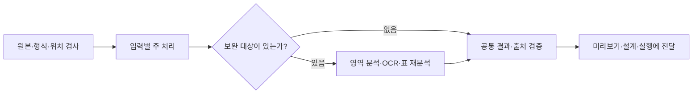
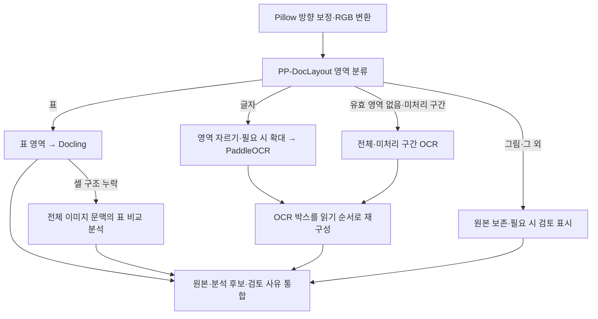
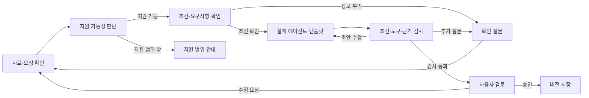
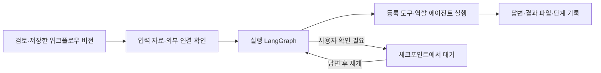

# A4B | Automation for Business

> 한국어로 설명한 반복 업무를 검토 가능한 워크플로우로 설계하고, 자료가 바뀌어도 같은 기준으로 다시 처리할 수 있도록 돕는 AI 업무 자동화 플랫폼입니다.

A4B는 재고·매출표, 문서·영수증, Gmail 등 업무 자료를 연결하고 요청에 따라 역할별 AI 에이전트와 업무 도구를 조합해 처리 순서를 구성합니다. 담당자는 작업 단계와 조건을 확인해 버전으로 저장하고, 결과 파일·실행 기록·원문 근거를 한 작업 공간에서 관리합니다.

**SK네트웍스 Family AI 캠프 33기 최종 프로젝트 5팀** · [A4B 서비스](https://app.a4b.site)


## 목차

1. [팀 소개](#1-팀-소개)
2. [프로젝트 개요](#2-프로젝트-개요)
3. [주요 기능](#3-주요-기능)
4. [업무 자료와 결과](#4-업무-자료와-결과)
5. [시스템 아키텍처](#5-시스템-아키텍처)
    - [문서 파서 라우팅](#문서-파서-라우팅)
    - [데이터 저장·예약·운영](#데이터-저장예약운영)
6. [멀티에이전트와 LangGraph](#6-멀티에이전트와-langgraph)
    - [워크플로우 설계 그래프](#워크플로우-설계-그래프)
    - [설계와 실행의 분리](#설계와-실행의-분리)
    - [SVM56 도구 추천](#svm56-도구-추천)
    - [설계 모델 학습과 서비스 검증](#설계-모델-학습과-서비스-검증)
    - [피드백과 되묻기](#피드백과-되묻기)
7. [프로젝트 구조](#7-프로젝트-구조)
8. [기술 스택](#8-기술-스택)
9. [로컬 실행 및 환경 설정](#9-로컬-실행-및-환경-설정)
10. [테스트와 배포](#10-테스트와-배포)
    - [개발 평가 결과](#개발-평가-결과)
    - [테스트 명령](#테스트-명령)
    - [배포 흐름](#배포-흐름)
11. [프로젝트 한계점 및 향후 개선 방향](#11-프로젝트-한계점-및-향후-개선-방향)
12. [프로젝트 제출 문서](#12-프로젝트-제출-문서)

---

## 1. 팀 소개

SK네트웍스 Family AI 캠프 33기 최종 프로젝트 5팀입니다.

| 이름 | GitHub |
| :---: | :---: |
| 김문규 | [tender0602](https://github.com/tender0602) |
| 박기현 | [HYonthePark](https://github.com/HYonthePark) |
| 김정재 | [kimjeongjaeae](https://github.com/kimjeongjaeae) |
| 정현두 | [gusen8684](https://github.com/gusen8684) |
| 채수환 | [suhoo898](https://github.com/suhoo898) |

---

## 2. 프로젝트 개요

### 배경 및 필요성

같은 종류의 자료를 주기적으로 처리하는 업무에서는 **어떤 열을 읽고, 어떤 조건으로 선별하며, 빈 값이나 예외를 어떻게 다룰지**가 중요합니다. 이 기준이 대화나 담당자의 기억에만 남으면 자료가 바뀔 때마다 같은 결정을 다시 확인해야 합니다. A4B는 **업무 기준과 처리 단계를 워크플로우로 저장해 반복 업무에 적용**합니다.

영수증 입력, 메일 공유, 고객 문의 검토처럼 자료에서 시작하는 업무를 하나의 작업 공간에서 구성하고, 다음 자료에도 같은 절차를 사용할 수 있도록 합니다. 문서 해석과 설계에 필요한 모델은 팀이 운영하는 서버에 직접 배치하며, 사용자가 연결한 Gmail·Slack 등의 업무 서비스는 별도 권한으로 연동합니다.

### 프로젝트 목표

1. 자연어 업무 요청과 연결된 자료를 바탕으로 검토할 수 있는 워크플로우를 구성합니다.
2. 담당자가 확정한 조건과 작업 순서를 버전으로 저장해 재사용합니다.
3. 실행 결과와 단계별 기록, 문서 원문 근거를 함께 제공해 결과를 확인할 수 있게 합니다.

### 문제 정의

> 업무 담당자가 반복 업무의 기준을 명확하게 정하고, 새 자료에도 같은 절차를 적용하며, 결과가 만들어진 과정을 확인할 수 있도록 합니다.

| 항목 | A4B에서 다루는 내용 |
| :--- | :--- |
| 주요 사용자 | 반복 업무를 설계·수행하는 담당자와 결과를 검토하는 담당자 |
| 입력 | 한국어 업무 요청, 표·문서·이미지 파일, 연결된 서비스의 자료 |
| 처리 | 조건 확인, 작업 단계 구성, 등록된 도구와 모델을 이용한 업무 처리 |
| 결과 | 저장된 워크플로우, 답변 또는 결과 파일, 실행 기록과 원문 근거 |

### 핵심 접근

| 업무에서 생기는 문제 | A4B의 접근 |
| :--- | :--- |
| 같은 파일 안에도 본문·표·이미지가 섞여 있음 | 형식과 영역에 따라 파서를 나누고 분석 결과를 공통 구조로 연결 |
| 대화 중 조건이 추가·변경되거나 모호하게 남음 | 대화와 확정 조건·질문 답변을 함께 관리하고 초안을 검증 |
| 자료가 바뀔 때마다 같은 업무를 다시 설명해야 함 | 검토한 워크플로우를 버전으로 저장하고 새 자료로 직접·예약 실행 |

### 사용 흐름

| 순서 | 사용자 작업 | 서비스 처리 |
| :--- | :--- | :--- |
| 1. 업무 설명 | 홈 또는 새 워크플로우에서 원하는 업무와 결과를 입력 | 요청과 연결 자료 확인 |
| 2. 자료 연결 | 표·문서·이미지 파일을 첨부하거나 자료함에서 선택 | 파일 분석과 미리보기 제공 |
| 3. 조건 확인 | 필요한 확인 질문에 답변 | 확정 조건을 반영하고 초안 구성 |
| 4. 초안 검토·저장 | 노드별 처리 내용과 설정 확인 후 승인 | 검증을 통과한 워크플로우를 버전으로 저장 |
| 5. 실행 | 직접 실행하거나 예약 등록 | 저장된 단계 실행, 필요 시 사용자 답변 대기 |
| 6. 결과 확인 | 답변·파일·단계별 기록 확인 | 결과와 실행 이력 제공 |

파일 연결은 자료를 읽는 단계입니다. 수행할 업무는 사용자의 요청으로 정하며, 필요한 조건이 충분하면 추가 질문 없이 초안을 구성합니다.

---

## 3. 주요 기능

### 3.1 자연어 워크플로우 설계

- 업무 목적, 자료, 원하는 결과를 한국어로 설명하면 사용할 도구와 처리 순서를 구성합니다.
- 조건이 빠졌거나 해석이 필요한 요청은 질문으로 확인하고, 담당자가 작업 단계와 설정을 검토합니다.
- 확인한 설계를 버전으로 저장하고 새 자료에 다시 적용합니다.

### 3.2 문서 업무 처리

- 표의 행 선별·집계·정렬과 결과 파일 생성을 조합합니다.
- PDF와 문서의 본문·표를 읽고 이미지나 스캔 자료의 문자를 OCR로 추출합니다.
- 정책 문서 기반 답변과 고객 응대 검수에서는 답변과 함께 확인할 원문 근거를 제공합니다.
- 문서의 반복 항목 추출에서는 파서가 제공한 표의 행·열 구조를 활용하고, 요청한 항목을 결과 열로 구성합니다.

문서 분석은 형식과 설치 환경에 따라 문서 리더·OCR·GPU 파서를 조합합니다. 부분적으로 읽힌 자료나 확인이 필요한 내용은 경고·검토 정보로 구분합니다.

### 3.3 자료함과 작업 라이브러리

- 개인·팀 자료함에서 파일과 폴더를 관리하고 업무에 필요한 자료를 연결합니다.
- 자주 쓰는 작업은 작업 라이브러리에 보관하고 다른 워크플로우에서 재사용합니다.
- 저장된 워크플로우를 검색·폴더별로 관리하고, 설계 열기·실행·예약 관리로 이동합니다.
- 워크플로우 삭제 시 예약을 해제하고 대기 작업을 취소하며, 기존 버전과 실행 기록은 보존합니다. 실행 중이거나 답변을 기다리는 작업은 완료한 뒤 삭제합니다.

| 자료함 읽기 방식 | 적용 기준 |
| :--- | :--- |
| 고정 파일 | 선택한 파일을 계속 참조 |
| 최신 파일 | 선택한 폴더의 가장 최근 파일을 참조 |
| 새 파일만 처리 | 이전에 성공 처리하지 않은 파일 버전만 선택 |
| 폴더 전체 함께 읽기 | 폴더의 처리 가능한 파일을 한 업무에 모아 사용 |

폴더 전체 방식은 최대 100개 파일을 지원합니다. 팀 자료는 현재 접근 권한을 확인해 사용하며, 실행 기록에는 당시 선택한 자료 버전을 남깁니다.

홈·설계 화면의 파일 첨부는 최대 10개, 파일당 8MB까지 지원합니다. 자료함의 폴더 읽기와 설계 화면 첨부는 서로 다른 선택 방식입니다.

### 3.4 실행 기록과 예약 업무

- 실행에 사용한 워크플로우 버전, 단계별 상태, 결과 파일, 추가 답변이 필요한 단계를 확인합니다.
- 매시간·매일·매주·매월 예약을 지원하고, 자료함의 새 파일을 반복 업무에 연결합니다. 예약 화면에서 다음 실행 시각과 활성 상태를 확인합니다.
- 사용자별 OAuth로 연결한 Gmail의 메일을 조회해 요약 업무에 활용합니다. 전날 메일 요약은 예약 시간대를 기준으로 조회 범위를 계산합니다.

### 3.5 외부 서비스 연결

| 서비스 | 제공 기능 | 연결 권한 |
| :--- | :--- | :--- |
| Gmail | 메일 조회·요약에 사용할 자료 읽기 | 읽기 |
| Google Sheets | 시트 조회와 결과 행 기록 | 읽기·수정 |
| Slack | 워크플로우 결과를 선택한 채널로 전송 | 메시지 전송·채널 조회 |

외부 서비스는 사용자 계정별 OAuth 연결을 사용합니다. 해당 서비스가 필요한 워크플로우는 연결 상태와 필요한 권한을 확인한 뒤 실행합니다.

### 3.6 관리자 모니터링

- 설계·실행·문서 분석 등의 요청 상태와 실패 위치·사유를 조회합니다.
- 요청별 진행 기록과 진단 정보를 확인하고, 처리 상태와 메모를 관리합니다.
- 활성 관리자 권한이 있는 계정에서 운영 PostgreSQL 저장소를 통해 사용합니다.

---

## 4. 업무 자료와 결과

| 업무 예시 | 입력 자료 | 결과 |
| :--- | :--- | :--- |
| 부족 재고 선별 | 상품별 현재 수량과 발주 기준이 있는 재고표 | 조건에 맞는 상품 목록과 CSV 결과 |
| 매출 집계 | 거래 내역 표 | 팀별 합계와 조건에 맞는 결과 파일 |
| 영수증 정리 | 영수증 사진 또는 문서 | 추출한 항목·금액을 정리한 표 |
| 문서 기반 답변 | 정책·업무 문서와 질문 | 답변 초안과 참조한 원문 |
| 메일 요약 | 사용자 계정에 연결된 Gmail 메일 | 지정한 기간의 메일 요약과 실행 기록 |

다음은 처리 기준을 설명하기 위한 예시입니다. “재고표에서 현재 수량이 발주 기준보다 적은 상품만 정리하고, 수량이 빈 행은 제외해 줘”라는 요청에서는 **같은 행의 수량을 비교하는 조건과 빈 값 처리 기준**이 워크플로우에 남습니다. 다음 재고표를 처리할 때도 이 기준을 사용할 수 있습니다.

| 상품 | 현재 수량 | 발주 기준 | 결과 |
| :--- | ---: | ---: | :--- |
| 키보드 | 20 | 30 | 부족 재고에 포함 |
| 모니터 | 10 | 10 | 기준을 충족해 제외 |
| 마우스 | — | 5 | 수량이 비어 있어 제외 |

이 예시에서는 **키보드 한 품목**만 결과에 남습니다.

---

## 5. 시스템 아키텍처

A4B는 웹 화면과 API, 워크플로우 설계·실행 워커, 업무 데이터 저장소, GPU 모델·문서 분석 서비스로 구성됩니다.


| 구성 요소 | 역할 |
| :--- | :--- |
| CloudFront·ACM | `app.a4b.site`의 HTTPS 접속 |
| EC2·Docker | React 화면, Node.js API, Python 워커 운영 |
| Cognito | 사용자 로그인과 인증 |
| PostgreSQL/RDS | 워크플로우, 실행 기록, 예약과 체크포인트 저장 |
| S3·앱 데이터 볼륨 | 업로드 원본, 결과 파일과 앱 데이터 보관 |
| RunPod | Qwen3.5 계열 모델 추론과 GPU 문서 분석 서비스 |
| GitHub Actions·ECR·SSM | 앱 이미지 검증·게시와 EC2 배포 |

웹 화면과 Node.js API가 사용자 요청을 받고, API는 Python 워커에 작업을 전달합니다. 워커가 설계·실행 그래프와 등록 도구를 호출하며, 모델 서버와 문서 분석 서비스는 필요한 단계에서 사용합니다. 실제 모델과 분석 엔진은 배포 환경 설정에 따라 선택됩니다.

로컬 업무 데이터는 SQLite를 사용하고, 공개 서비스는 PostgreSQL을 사용하도록 검사합니다. PostgreSQL에서는 개인·팀 작업 공간을 구분하고 행 수준 보안(RLS)을 적용합니다. LangGraph 체크포인트도 선택한 업무 저장소에 맞춰 관리합니다.

### 문서 파서 라우팅

문서마다 본문·표·이미지의 구조가 다르므로 **원본 검사 → 형식별 주 처리 → 필요한 영역 보완 → 검증·반환**으로 나눕니다. 모든 파일에 모든 엔진을 실행하지 않고, 처리 결과에서 누락이나 구조 손실이 확인된 경우에 제한적으로 보완합니다.



#### 입력별 주 처리와 실행 위치

| 입력 | 주 처리 경로 | 보완과 제약 |
| :--- | :--- | :--- |
| PDF | 외부 파서 설정 시 AWS에서 원본을 RunPod에 제출. Pod는 원본 검사 후 MinerU가 설정돼 있으면 우선 사용하고, 실패 시 Docling으로 전환. MinerU 미설정 시 Docling으로 시작 | 필요한 이미지 영역만 OCR·표 분석. 셀 구조가 없는 표는 해당 페이지를 Docling 비교 후보로 재분석. GPU 주 엔진이 모두 실패하면 작업 실패 반환 |
| 이미지·영수증 | AWS에서 Pillow로 방향·RGB 등을 정리하고 PP-DocLayout으로 영역 분류 | 글자 영역은 PaddleOCR, 표 영역은 Docling. 유효 영역을 찾지 못하면 전체 이미지 OCR, 미처리 구간이 발견되면 추가 OCR |
| Word·PowerPoint | OOXML과 native reader로 본문·표·객체의 원본 구조를 읽고 Docling 결과는 별도 후보로 보관 | 내장 이미지에 필요한 보완만 수행. DOC·PPT는 형식 변환 환경 필요 |
| Excel·CSV·TSV·TXT·MD | OOXML·openpyxl·표준 reader로 원본 값과 구조를 직접 읽음 | 시트·셀·수식·병합 정보 또는 행·원문을 형식에 맞게 보존. XLS는 변환 환경 필요 |
| HWP·HWPX | rhwp로 PDF 사본을 만든 뒤 원본 검사·Docling 분석 | 변환 및 분석 의존성이 필요하며, 코드 경로의 존재와 운영 지원 완료는 구분 |

여기서 native는 AI 모델 이름이 아니라 **원본 파일의 데이터 구조를 직접 읽는 경로**입니다. 원격 파서가 없는 경우 앱의 분석 워커가 로컬 라우터를 실행하며, 로컬 PDF 주 파서 기본값은 MinerU입니다.

#### 이미지·표의 조건부 보완



Pillow는 전처리와 영역 자르기를, PP-DocLayout은 위치·유형 분류를, PaddleOCR는 글자 인식을 담당합니다. Docling은 문서·표 구조를 분석하며 내부 OCR 설정은 별도 PaddleOCR 단계와 구분합니다. 구조 누락이나 모호한 객체는 검토 대상으로 남기고, 보완 후보로 원본 값을 무조건 덮어쓰지 않습니다.

#### AWS·RunPod 역할과 작업 관리

- **AWS:** 원본 읽기·이미지 전처리·라우팅·결과 통합을 담당합니다. 일부 원격 layout/OCR 오류는 설정된 정책에 따라 CPU 처리로 대체합니다.
- **RunPod:** PDF 전체 분석과 이미지 layout/OCR 추론, 이미지 표의 Docling 보완을 수행합니다. layout/OCR 모델은 서버에서 재사용하고, PDF·이미지 Docling은 공유 작업 슬롯을 관리합니다.
- **작업 수명주기:** 긴 작업은 ID로 접수한 뒤 상태를 조회합니다. 시간 초과·취소·조회 중단 시 작업과 자식 프로세스를 정리합니다. 이미지 표 보완에는 문서 전체 시간 예산을 적용하며, 경합·시간 초과 시 기존 결과와 검토 사유를 보존합니다.

외부 PDF나 이미지 Docling의 오류를 항상 로컬 재처리로 전환하는 것은 아닙니다. 원격 작업 실패, 제한된 보완 이후의 부분 결과, 내용 검토가 필요한 상태를 구분합니다.

#### 공통 결과 계약과 원본 추적

엔진마다 다른 결과는 **본문·표 셀·원본 위치·좌표·부모 객체·엔진·처리 경로·검토 사유**를 가진 공통 블록으로 통합합니다. 객체 참조와 좌표·결과 크기 등을 검사하고, 원격 결과는 원본 SHA-256도 확인합니다. 미리보기·설계·실행은 이 결과를 함께 사용합니다.

원본 추적과 결과 규격 검증은 내용 정확도 평가와 구분합니다. 누락 검사나 재분석이 모든 인식 오류를 발견·복원한다는 의미는 아닙니다. 과거 파서 A/B 수치와 합성 입력의 운영 연결 시험 역시 현재 버전 전체의 정확도로 표시하지 않습니다.

### 데이터 저장·예약·운영

| 설계 요소 | 처리 방식과 목적 |
| :--- | :--- |
| 버전과 실행 입력 | 검토한 워크플로우 버전과 선택한 자료 정보를 기록해 실행 당시의 설정과 입력을 확인 |
| 개인·팀 작업 공간 | API 권한 검사와 PostgreSQL의 작업 공간 조건·RLS로 접근 범위를 구분 |
| 예약 실행 | 다음 실행 시각을 확인해 작업을 확보하고, lease와 실행 상태를 관리하며 저장한 자료 선택 방식 적용 |
| 워커 동시 처리 | 일반·장시간·제어 요청을 구분해 실행이 길어져도 상태 갱신·중단 요청이 같은 대기열에 묶이지 않도록 구성 |
| 모니터링 | 요청과 단계별 상태·실패 사유를 남겨 관리자가 문제 위치를 확인하고 처리 이력 관리 |

---

## 6. 멀티에이전트와 LangGraph

A4B는 **역할을 나눠 업무를 설계하고 처리하는 멀티에이전트 플랫폼**입니다. 설계 단계에서는 설계 에이전트나 업무 템플릿이 워크플로우 초안을 만들고, 저장된 워크플로우에서는 업무 처리·근거 기반 답변·고객 응대 검수 에이전트가 필요한 단계에 배치됩니다. 각 에이전트는 실제 입력과 앞 단계의 결과를 받아 맡은 작업을 수행합니다. LangGraph는 이 단계들의 연결, 조건 분기, 되묻기, 사용자 검토와 실행 상태를 관리합니다.

### 역할별 AI 에이전트

| 에이전트 | 사용되는 단계 | 하는 일 |
| :--- | :--- | :--- |
| 워크플로우 설계 에이전트 | 설계 초안 작성 | 요청·연결 자료·등록된 도구의 규격을 조회해 질문 또는 작업 단계 초안을 만듭니다. 정해진 업무에는 템플릿으로 초안을 만드는 경로도 있습니다. |
| 업무 처리 에이전트 (`agent_node`) | 저장된 워크플로우의 역할 수행 | 지정된 역할과 실제 입력을 읽고 텍스트 결과를 만듭니다. 문의 분석, 응대 초안 작성처럼 서로 다른 역할을 각각의 단계로 구성할 수 있습니다. |
| 근거 기반 답변 에이전트 (`compose_answer`) | 문서 답변·요약 | 검색하거나 전달받은 문서 원문을 확인해 답변·요약과 근거를 작성합니다. |
| 고객 응대 검수 에이전트 (`reply_review`) | 고객 응대 검수 | 고객 문의·정책·응대 초안을 확인하고 문제 구절, 판정과 수정 제안을 검수 결과로 남깁니다. |

저장된 워크플로우는 포함된 단계의 에이전트만 호출합니다. 예를 들어 고객 응대 업무에서는 문의 분석 에이전트의 결과를 응대 초안 에이전트가 이어받고, 검수 에이전트가 초안을 점검하도록 연결할 수 있습니다. 필요하면 검수 의견을 수정 단계에 전달해 초안을 다시 작성합니다. 검수 결과를 바탕으로 최종 응대를 승인할지는 담당자가 결정합니다.

### 워크플로우 설계 그래프



모델이 만든 초안에는 조건 누락이나 잘못된 도구 연결이 포함될 수 있습니다. 따라서 요청 해석·조건 확인·생성·검증·감독을 LangGraph 단계로 나누고, 각 단계의 상태에 따라 **질문·수정·승인 경로를 선택**합니다. 대화형 초안 작성은 기본 설정에서 Deep Agents를 사용하며, 일부 업무는 템플릿 경로로 처리합니다.

**LangGraph는 단계 간 흐름과 상태를 관리**하고, **Deep Agents는 자료·도구를 확인해 초안을 구성**합니다. 흐름 제어와 설계 판단을 나눠, 질문에 답하거나 초안을 수정할 때도 현재 상태에 맞는 단계에서 이어가도록 구성했습니다.

검증에서는 **연결 자료의 종류, 노드 설정, 입출력 포트와 처리 순서, 사용자 조건의 반영 여부**를 확인합니다. **필수 질문이나 검증 오류가 남으면 저장을 막고**, 저장 직전에도 승인 상태와 초안을 다시 검사합니다. 조건·요구사항 검사와 보조 모델 검토의 적용 범위는 환경 설정에 따릅니다.

### 설계와 실행의 분리

설계할 때 정한 조건을 새 자료에도 적용하려면, 검토한 설정과 실제 처리 절차가 연결돼 있어야 합니다. 설계 그래프는 **무엇을 어떤 조건으로 처리할지** 정하고, 실행 그래프는 **저장된 버전의 설정에 따라 실제 자료를 처리**합니다. 표 선별·정렬·집계·파일 생성은 등록된 코드가 수행하고, 역할 수행·답변·검수 등 필요한 단계에서 모델을 호출합니다.



### SVM56 도구 추천

SVM56은 **문자 조각 기반 TF-IDF와 선형 SVM**으로 요청에 맞는 도구 후보를 추천해 설계를 보조합니다. 추천 결과로 사용 가능한 도구를 제한하지 않고, 설계 단계가 전체 등록 도구와 입력·출력 계약을 확인해 실제 연결을 구성합니다. 추천 점수는 확률이 아니며, 다중 턴이나 취소 표현 등 추천을 보류하는 경우에도 기존 설계 경로를 유지합니다.

### 설계 모델 학습과 서비스 검증

설계 모델은 도구 선택·처리 순서·입력 연결·업무 조건을 포함한 예시를 바탕으로 Qwen3.5 9B를 QLoRA 방식으로 두 차례 학습했습니다. 1차는 원문 35개를 조건별로 구성한 105행, 2차는 합성 업무 928개에서 구성한 2,656행을 사용했습니다.

모델 학습은 초안을 구성하는 능력을 개선하고, 서비스 코드는 질문·답변 연결과 확정 조건·도구 연결·저장 가능 여부를 검사합니다. 모델 개발 평가는 최종 출력의 정답 일치 여부로 비교하고, 서비스 회귀 검사는 변경 후 기존 처리 흐름이 유지되는지 확인합니다.

### 피드백과 되묻기

되묻기 답변은 대화에 남기면서 질문 식별자·답변 이력과 조건·요구사항 상태에도 반영합니다. 후속 요청은 새 메시지만 따로 처리하지 않고, **이전에 확정한 조건 및 현재 초안과 함께 검토**합니다. 필요한 정보가 남아 있으면 질문을 이어가고, 조건이 충분하면 초안 검증과 사용자 검토로 진행합니다.

설계 중 질문에 답하는 과정과 저장된 워크플로우 실행 중 답변을 기다리는 과정은 구분됩니다. 실행 중 사용자 확인이 필요한 노드는 체크포인트에서 멈추고, 답변을 받은 뒤 같은 실행을 이어갑니다.

---

## 7. 프로젝트 구조

```text
SKN33-Final-5Team/
├── Frontend/                 # React·TypeScript 화면
├── Backend/
│   ├── api/                  # Node.js API
│   ├── agent_builder/        # 자연어 요청과 워크플로우 설계
│   ├── workflow_engine/      # 저장된 워크플로우 실행과 도구 카탈로그
│   ├── documents/            # 문서 분석·OCR·원문 근거
│   ├── contracts/            # 설계·노드·질문 데이터 계약
│   ├── infrastructure/       # 모델 연결·업무 저장소·체크포인트
│   ├── ml/svm56/             # 도구 추천 모델
│   ├── service/              # Python 워커와 기능별 요청 처리
│   └── tests/                # 설계·실행·문서·저장소 회귀 테스트
├── shared/                   # 화면과 API의 공통 규격
├── runtime/ml-bundle/        # SVM 모델과 카탈로그
├── infrastructure/           # Docker·DB 마이그레이션·배포 설정
├── scripts/                  # 설정·검증·배포 스크립트
├── .github/workflows/        # 배포 전 검사·이미지 게시·배포
└── docs/                     # README 이미지와 프로젝트 제출 문서
```

자연어 설계의 중심은 `Backend/agent_builder/design/graph.py`, 저장된 워크플로우 실행의 중심은 `Backend/workflow_engine/runner.py`입니다. 별도 시각 편집기와 TypeScript 실행 엔진도 함께 유지하고 있습니다.

---

## 8. 기술 스택

| 영역 | 기술 |
| :--- | :--- |
| 프런트엔드 | React 19, TypeScript, Vite |
| API·워커 | Node.js, Python |
| 워크플로우 | Deep Agents, LangGraph, 등록 도구 카탈로그 |
| 모델·추천 | Qwen3.5, Ollama·vLLM 연결, scikit-learn SVM56 |
| 문서 분석 | 문서 리더, MinerU, Docling, PaddleOCR 등 형식별 분석 경로 |
| 데이터·인증 | PostgreSQL, SQLite, S3, Amazon Cognito |
| 배포 | Docker, GitHub Actions, Amazon ECR, AWS SSM, EC2 |

---

## 9. 로컬 실행 및 환경 설정

### 사전 준비

- Node.js **22.13 이상**. 배포 CI는 Node.js 24를 사용합니다.
- Python **3.11~3.14**. 배포 CI는 Python 3.11을 사용합니다.
- Ollama 또는 접근 가능한 Qwen 모델 서버.
- PDF·OCR 등 문서 분석을 사용할 경우 해당 Python 환경·모델 또는 외부 파서 연결.

### 로컬 Ollama로 실행

저장소 루트에서 실행합니다. 아래 모델은 로컬 실행 예시이며, 운영 서버의 모델 설정과 별개입니다.

```bash
npm ci
npm run setup
cp infrastructure/env/.env.example .env

ollama pull qwen3.5:4b
ollama create a4b-qwen35-4b-16k -f scripts/setup/ollama/Modelfile.a4b-qwen35-4b-16k

npm run dev
```

Windows에서는 파일 복사 단계에 `Copy-Item infrastructure/env/.env.example .env`를 사용할 수 있습니다. 기존 `.env`가 있다면 필요한 설정을 비교해 반영합니다.

예제 `.env`의 포트는 `3041`이므로 `http://127.0.0.1:3041`에 접속합니다. 다른 포트를 지정했다면 해당 주소를 사용합니다. `npm run dev`는 프런트엔드·API를 빌드한 뒤 Node.js 서버를 실행합니다.

| 설정 | 용도 |
| :--- | :--- |
| `A4B_LLM_BASE_URL` | Ollama 호환 모델 서버 주소. 예: `http://127.0.0.1:11434/v1` |
| `A4B_LLM_MODEL` | 서버에 준비한 모델 이름 |
| `A4B_PLANNER_MODE` | 초안 생성 방식. 예제는 `deepagent` |
| `A4B_CAPABILITY_MODE`, `A4B_CONDITION_MODE` | 지원 가능성·업무 조건 검사 |
| `A4B_REQUIREMENT_MODE` | 별도 요구사항 상태·충족 여부 검사 |
| `A4B_STORAGE` | 업무 데이터 저장소. 로컬 `sqlite`, 운영 `postgres` |
| `EASYFLOW_DATA_DIR` | 로컬 데이터 저장 위치 |
| `PORT` | 웹·API 서버 포트 |

명시적인 `A4B_MAIN_*` 모델 연결 설정은 공통 `A4B_LLM_*` 설정보다 우선합니다. 검사 모드의 적용 범위는 실행 환경에 따라 달라지므로 [환경 변수 예제](infrastructure/env/.env.example)를 함께 확인합니다.

### 문서 분석 환경

기본 agent 설치와 문서 분석 환경은 분리되어 있습니다. 기본 문서 리더는 다음 스크립트로 준비합니다.

```bash
bash scripts/setup/setup-document-analysis.sh
```

Docling 환경은 `npm run setup:docling`으로 설치할 수 있습니다. OCR·GPU 분석 엔진의 모델 가중치와 실행 경로는 별도로 준비해야 합니다. 외부 파서는 `A4B_PARSER_URL` 등 연결 설정을 사용합니다. 자세한 구성은 [RunPod 파서 안내](scripts/runpod/README.md)를 참고합니다.

### Docker 실행

호스트 또는 외부 모델 서버를 준비한 뒤 모델 주소 등 `.env` 설정을 확인하고 실행합니다.

```bash
docker compose up -d --build
```

기본 접속 주소는 `http://127.0.0.1:3030`이며 `A4B_DOCKER_PORT`로 변경할 수 있습니다. 호스트의 Ollama를 사용할 때는 `.env`의 `A4B_MAIN_BASE_URL=http://host.docker.internal:11434/v1`, `A4B_MAIN_MODEL=a4b-qwen35-4b-16k`처럼 컨테이너에서 접근할 주소와 준비한 모델을 지정합니다. 앱 데이터는 Docker 볼륨에 보관하고 SVM bundle은 읽기 전용으로 연결합니다.

운영 구성은 [데이터베이스·저장소 설계 문서](<docs/03_데이터 수집 및 저장/데이터베이스·저장소 설계 문서.docx>)와 [시스템 구성도](<docs/06_서비스 배포 및 테스트/시스템 구성도.pdf>)에서 확인할 수 있습니다.

---

## 10. 테스트와 배포

### 개발 평가 결과

다음은 팀 발표 자료에 정리한 개발 평가 결과입니다. 평가 대상과 성공 기준을 구분해 해석합니다.

| 평가 대상 | 결과 | 평가 범위 |
| :--- | ---: | :--- |
| SVM 도구 추천 F1 | **92.45%** | 5,431건에서 판정된 라벨만 채점, 동일 5-fold 교차검증 |
| SVM Completeness@3 | **95.37%** | 전체 라벨이 판정된 1,577건에서 필요한 도구가 상위 3개 후보에 모두 포함된 비율 |
| 설계 모델 1차 → 2차 | **2/320 → 194/320** | 동일 개발 업무 320건의 최종 출력 정답 일치. 2차 결과 일치율 60.6% |

이 수치는 **당시 개발 평가 환경의 결과**이며, 현재 main을 새로 측정한 결과나 운영 서비스 전체의 성공률은 아닙니다. 도구 추천 성능과 워크플로우 최종 결과의 정확도도 서로 다른 지표입니다.

### 테스트 명령

```bash
npm run check               # 프런트엔드·API 타입 검사
npm test                    # 빌드 후 프런트엔드·API Node 테스트
npm run test:python         # Python 테스트
npm run ml:check -- --probe  # SVM bundle과 실제 추천 연결 검사
```

문서 분석·PostgreSQL·외부 서비스 테스트는 각각 필요한 환경과 연결 설정을 준비해야 합니다.

| 검증 대상 | 검사하는 내용 |
| :--- | :--- |
| 프런트엔드 DOM·상태 | 대화·질문 폼·첨부·화면 전환·예약 등 사용자 동작 |
| API | 인증·입력 검증·업로드·외부 연결·워커 제어 |
| 설계·되묻기 | 고정 모델 응답을 사용한 질문·답변 연결, 조건 유지·수정·취소, 저장 차단 |
| 실행 엔진 | 합성 표 등을 실제로 처리해 결과 행·분기·출력 계약 확인 |
| 문서 분석 | 분석 결과 계약·표 구조·반복 항목 추출·부분 실패 처리 |
| 저장소·예약 | SQLite·PostgreSQL 동작, 작업 공간 격리, 예약·lease·이력 보존 |

고정 응답 회귀 테스트와 실제 모델 평가는 구분합니다. 회귀 테스트 통과는 확인한 시나리오의 코드 동작을 검증하며, 운영 모델이 다양한 요청에서 항상 올바른 설계를 만든다는 의미는 아닙니다.

### 배포 흐름

```text
main 변경 → 배포 대상 판별 → 대상별 검사 → Docker 이미지 게시(ECR)
          → SSM을 통한 EC2 배포 → 실행 환경·서비스 확인
```

GitHub Actions에서 프런트엔드·백엔드·전체 배포를 구분합니다. 백엔드 포함 배포에서는 타입 검사·Node 테스트와 지정된 Python 회귀·PostgreSQL 저장소 검사 등을 수행하고, 프런트엔드 전용 배포는 해당 영역을 검사합니다. 검증된 이미지 재사용과 복귀 절차도 제공합니다.

배포 전 Python 검사는 워크플로우에 명시한 목록을 대상으로 하므로, 모든 Python 테스트를 매 배포마다 실행하는 것은 아닙니다. 실제 검사 목록과 자동 실행 조건은 [배포 워크플로우](.github/workflows/deploy.yml)에서 관리합니다.

---

## 11. 프로젝트 한계점 및 향후 개선 방향

개발 평가와 서비스 구현에서 확인한 한계를 바탕으로, 처음 보는 업무에 대한 대응과 후속 답변 반영, 처리 속도와 문서·외부 연동 검증을 개선합니다.

| 보완할 부분 | 현재 한계 | 개선 방향 |
| :--- | :--- | :--- |
| 다양한 업무 요청 | 합성·시나리오 중심 평가로 실제 업무 표현과 예외 상황의 검증 범위가 제한됨 | 실사용 요청·실패 사례를 별도 평가 세트로 축적하고 학습·검증 자료 확대 |
| 다중 턴 조건 관리 | 복합 요청에서 조건 누락·불필요한 재질문·답변 반영 오류가 발생할 수 있음 | 질문·답변·조건 상태의 연결을 강화하고 같은 대화의 수정 전후 결과를 회귀 검사 |
| 설계 응답 속도 | 단계별 모델 호출과 문서 분석 대기로 처리 시간이 길어질 수 있음 | 단계별 소요 시간을 바탕으로 병목을 확인하고 확정 상태·정형 처리의 불필요한 재호출 축소 |
| 문서 분석 | 스캔 품질·병합 셀·여러 페이지 표에 따라 추출 결과 확인이 필요함 | 문서 유형별 정답 세트를 확대하고 부분 분석·대조 검토·오류 복구 개선 |
| 외부 서비스 연동 | 모델·파서 가용성, 계정 권한과 API 제한에 영향을 받음 | 시험용 계정을 통한 연동 검사와 연결 상태·단계별 실패 진단 강화 |

---

## 12. 프로젝트 제출 문서

| 단계 | 제출 문서 |
| :--- | :--- |
| 02 기획 | [요구사항 정의서](<docs/02_기획/요구사항 정의서.xlsx>) · [프로젝트 기획서](<docs/02_기획/프로젝트 기획서.docx>) |
| 03 데이터 수집 및 저장 | [데이터베이스·저장소 설계 문서](<docs/03_데이터 수집 및 저장/데이터베이스·저장소 설계 문서.docx>) · [수집 데이터 보고서](<docs/03_데이터 수집 및 저장/수집_데이터_보고서.pdf>) · [화면설계서](<docs/03_데이터 수집 및 저장/화면설계서.pdf>) |
| 04 데이터 전처리 | [데이터 전처리 결과서](<docs/04_데이터 전처리/데이터_전처리_결과서_33기_5팀.pdf>) |
| 05 모델링 및 평가 | [AI 시스템 아키텍처](<docs/05_모델링 및 평가/AI 시스템 아키텍처(멀티 에이전트 아키텍처).pdf>) · [머신러닝·딥러닝 학습결과서](<docs/05_모델링 및 평가/머신러닝·딥러닝_학습결과서.pdf>) · [자체 sLLM 인공지능](<docs/05_모델링 및 평가/자체 sLLM 인공지능.pdf>) · [학습한 ML·DL 모델](<docs/05_모델링 및 평가/학습한_ML·DL_모델.pdf>) |
| 06 서비스 배포 및 테스트 | [LLM 연동 웹 애플리케이션](<docs/06_서비스 배포 및 테스트/개발된 LLM 연동 웹 애플리케이션팀.pdf>) · [서비스 테스트 계획 및 결과 보고서](<docs/06_서비스 배포 및 테스트/서비스 테스트 계획 및 결과 보고서.pdf>) · [시스템 구성도](<docs/06_서비스 배포 및 테스트/시스템 구성도.pdf>) |
| 07 발표 및 최종 제출 | [5팀 최종발표](<docs/07_발표 및 최종 제출/5팀_최종발표.pdf>) |
