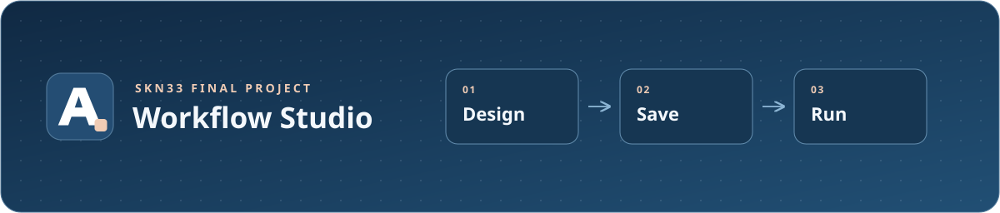
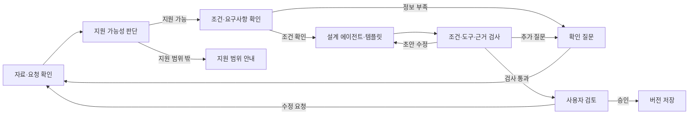
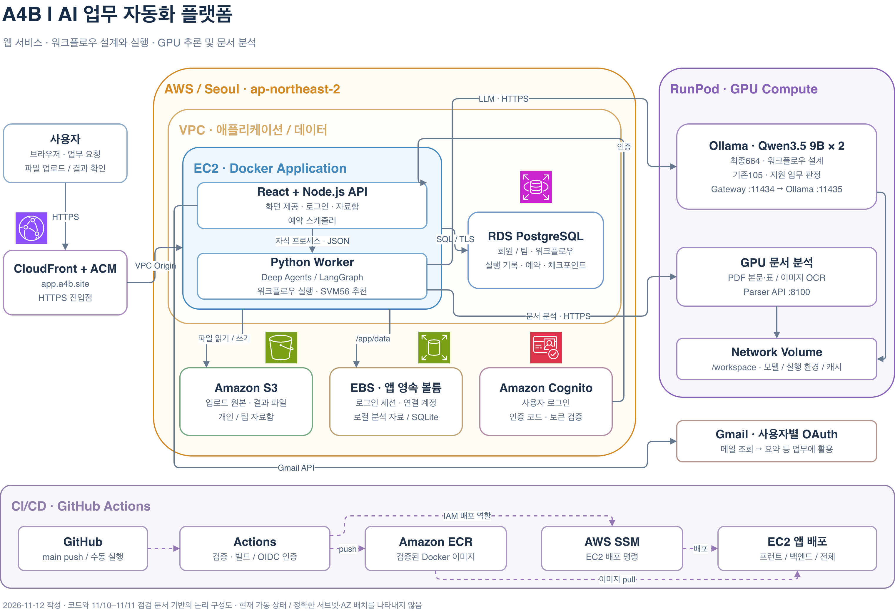

# A4B | AI for Business

> 한국어로 설명한 반복 업무를 검토 가능한 워크플로우로 설계하고, 자료가 바뀌어도 같은 기준으로 다시 처리할 수 있도록 돕는 AI 업무 자동화 플랫폼입니다.

A4B는 재고·매출표, 문서·영수증, Gmail 등 업무 자료를 연결하고 요청에 따라 역할별 AI 에이전트와 업무 도구를 조합해 처리 순서를 구성합니다. 담당자는 작업 단계와 조건을 확인해 버전으로 저장하고, 결과 파일·실행 기록·원문 근거를 한 작업 공간에서 관리합니다.

**SK네트웍스 Family AI 캠프 33기 최종 프로젝트 5팀** · [A4B 서비스](https://app.a4b.site)



## 목차

1. [팀 소개](#1-팀-소개)
2. [프로젝트 개요](#2-프로젝트-개요)
3. [멀티에이전트와 LangGraph](#3-멀티에이전트와-langgraph)
4. [주요 기능](#4-주요-기능)
5. [업무 자료와 결과](#5-업무-자료와-결과)
6. [시스템 아키텍처](#6-시스템-아키텍처)
7. [프로젝트 구조](#7-프로젝트-구조)
8. [기술 스택](#8-기술-스택)
9. [검증 범위](#9-검증-범위)
10. [프로젝트 한계점 및 향후 개선 방향](#10-프로젝트-한계점-및-향후-개선-방향)

---

## 1. 팀 소개

SK네트웍스 Family AI 캠프 33기 최종 프로젝트 5팀입니다.

[kimjeongjaeae](https://github.com/kimjeongjaeae) · [HYonthePark](https://github.com/HYonthePark) · [suhoo898](https://github.com/suhoo898) · [tender0602](https://github.com/tender0602) · [gusen8684](https://github.com/gusen8684)

---

## 2. 프로젝트 개요

### 배경 및 필요성

같은 종류의 자료를 주기적으로 처리하는 업무에서는 **어떤 열을 읽고, 어떤 조건으로 선별하며, 빈 값이나 예외를 어떻게 다룰지**가 중요합니다. 이 기준이 대화나 담당자의 기억에만 남으면 자료가 바뀔 때마다 같은 결정을 다시 확인해야 합니다. A4B는 업무 기준과 처리 단계를 워크플로우로 남겨 반복 업무에 적용합니다.

### 프로젝트 목표

1. 자연어 업무 요청과 연결된 자료를 바탕으로 검토할 수 있는 워크플로우를 구성합니다.
2. 담당자가 확정한 조건과 작업 순서를 버전으로 저장해 재사용합니다.
3. 실행 결과와 단계별 기록, 문서 원문 근거를 함께 제공해 결과를 확인할 수 있게 합니다.

### 문제 정의

> 업무 담당자가 반복 업무의 기준을 명확하게 정하고, 새 자료에도 같은 절차를 적용하며, 결과가 만들어진 과정을 확인할 수 있도록 합니다.

| 항목 | A4B에서 다루는 내용 |
| --- | --- |
| 주요 사용자 | 반복 업무를 설계·수행하는 담당자와 결과를 검토하는 담당자 |
| 입력 | 한국어 업무 요청, 표·문서·이미지 파일, 연결된 서비스의 자료 |
| 처리 | 조건 확인, 작업 단계 구성, 등록된 도구와 모델을 이용한 업무 처리 |
| 결과 | 저장된 워크플로우, 답변 또는 결과 파일, 실행 기록과 원문 근거 |

### 설계 정확도를 높이는 방식

A4B는 사용자 요청과 연결 자료를 기준으로 열 이름, 비교값, 빈 값 처리 같은 업무 조건을 확인합니다. 모델이 근거 없이 채운 조건은 질문으로 되돌리고, 담당자가 작업 단계와 조건을 검토한 뒤 설계를 저장합니다. 저장된 워크플로우 버전과 실행에 선택된 자료 버전은 실행 기록에 남겨 결과를 다시 확인할 수 있게 합니다.

---

## 3. 멀티에이전트와 LangGraph

A4B는 **역할을 나눠 업무를 설계하고 처리하는 멀티에이전트 플랫폼**입니다. 설계 단계에서는 설계 에이전트나 업무 템플릿이 워크플로우 초안을 만들고, 저장된 워크플로우에서는 업무 처리·근거 기반 답변·고객 응대 검수 에이전트가 필요한 단계에 배치됩니다. 각 에이전트는 실제 입력과 앞 단계의 결과를 받아 맡은 작업을 수행합니다. LangGraph는 이 단계들의 연결, 조건 분기, 되묻기, 사용자 검토와 실행 상태를 관리합니다.

### 역할별 AI 에이전트

| 에이전트 | 사용되는 단계 | 하는 일 |
| --- | --- | --- |
| 워크플로우 설계 에이전트 | 설계 초안 작성 | 요청·연결 자료·등록된 도구의 규격을 조회해 질문 또는 작업 단계 초안을 만듭니다. 정해진 업무에는 템플릿으로 초안을 만드는 경로도 있습니다. |
| 업무 처리 에이전트 (`agent_node`) | 저장된 워크플로우의 역할 수행 | 지정된 역할과 실제 입력을 읽고 텍스트 결과를 만듭니다. 문의 분석, 응대 초안 작성처럼 서로 다른 역할을 각각의 단계로 구성할 수 있습니다. |
| 근거 기반 답변 에이전트 (`compose_answer`) | 문서 답변·요약 | 검색하거나 전달받은 문서 원문을 확인해 답변·요약과 근거를 작성합니다. |
| 고객 응대 검수 에이전트 (`reply_review`) | 고객 응대 검수 | 고객 문의·정책·응대 초안을 확인하고 문제 구절, 판정과 수정 제안을 검수 결과로 남깁니다. |

저장된 워크플로우는 포함된 단계의 에이전트만 호출합니다. 예를 들어 고객 응대 업무에서는 문의 분석 에이전트의 결과를 응대 초안 에이전트가 이어받고, 검수 에이전트가 초안을 점검하도록 연결할 수 있습니다. 필요하면 검수 의견을 수정 단계에 전달해 초안을 다시 작성합니다. 검수 결과를 바탕으로 최종 응대를 승인할지는 담당자가 결정합니다.

### 워크플로우 설계 그래프



설계 과정에서는 요청 해석·지원 판단·조건 확인·초안 작성·검증·감독을 전문 단계로 나눠 **LangGraph 상태 그래프**에서 순서대로 조정합니다. 대화형 초안 작성은 기본 설정에서 Deep Agents를 사용하며, 확정된 일부 업무는 템플릿 경로로 처리합니다. 지원·조건 판단에는 필요에 따라 모델 판단과 코드 검사를 함께 사용합니다. 감독 단계는 검사 결과에 따라 수정, 질문, 승인 대기 또는 저장으로 경로를 정합니다.

| 설계·조정 단계 | 역할 |
| --- | --- |
| 요청 해석·지원 판단 | 업무 요청을 해석하고 등록된 도구로 처리할 수 있는지 확인합니다. |
| 조건·요구사항 확인 | 비교 열·기준값·빈 값 처리·예약 조건 등을 원문과 자료에 대조하고, 미정 항목을 질문으로 남깁니다. 적용 범위는 서비스 설정에 따릅니다. |
| 초안 검증·감독 | 도구 연결, 입력·출력, 사용자 근거를 검사하고 수정·되묻기·승인 대기·저장 경로를 결정합니다. 보조 모델 검토는 설정에 따라 사용합니다. |
| SVM56 도구 추천 | 요청에 맞는 도구 후보를 제안해 설계를 돕습니다. |
| 저장된 워크플로우 실행 | 별도 LangGraph가 저장된 단계를 연결해 결과와 체크포인트를 기록하고, 조건 분기나 사용자 응답 대기를 처리합니다. |

### 피드백과 되묻기

지원 판단, 업무 조건 확인, 요구사항 점검 또는 초안 검사에서 결정할 정보가 부족하면 확인 질문을 표시합니다. 질문에는 대화가 이어져도 유지되는 식별자를 부여합니다. 답변이 현재 질문에 맞는지 검사한 뒤 확정된 값과 원문 근거를 조건·요구사항 상태에 반영합니다. 이미 답한 조건의 재질문을 줄이도록 검사하고, 답변 이후에는 지원 가능성과 처리 조건을 다시 확인합니다.

초안에 오류가 있으면 수정하거나 추가 질문으로 돌아갑니다. 필수 질문이나 검증 오류가 남아 있으면 저장을 막고, 검토를 통과한 초안을 담당자가 승인하면 버전으로 저장합니다. 담당자가 수정을 요청하면 다시 설계·검사하며, 일시적인 처리 오류는 사용자에게 묻는 업무 조건과 구분합니다. 저장된 워크플로우에서 사용자 응답이 필요한 단계는 체크포인트에서 멈췄다가 답변을 받아 같은 실행을 이어갑니다. 조건·요구사항 검사의 적용 범위는 서비스 설정에 따릅니다.

---

## 4. 주요 기능

### 1. 자연어 워크플로우 설계

- 업무 목적, 자료, 원하는 결과를 한국어로 설명하면 사용할 도구와 처리 순서를 구성합니다.
- 조건이 빠졌거나 해석이 필요한 요청은 질문으로 확인하고, 담당자가 작업 단계와 설정을 검토합니다.
- 확인한 설계를 버전으로 저장하고 새 자료에 다시 적용합니다.

### 2. 표·문서 업무 처리

- 표의 행 선별·집계·정렬과 결과 파일 생성을 조합합니다.
- PDF와 문서의 본문·표를 읽고 이미지나 스캔 자료의 문자를 OCR로 추출합니다.
- 정책 문서 기반 답변과 고객 응대 검수에서는 답변과 함께 확인할 원문 근거를 제공합니다.

### 3. 자료함과 작업 라이브러리

- 개인·팀 자료함에서 파일과 폴더를 관리하고 업무에 필요한 자료를 연결합니다.
- 자주 쓰는 작업은 작업 라이브러리에 보관하고 다른 워크플로우에서 재사용합니다.

| 자료함 읽기 방식 | 적용 기준 |
| --- | --- |
| 고정 파일 | 선택한 파일을 계속 참조 |
| 최신 파일 | 선택한 폴더의 가장 최근 파일을 참조 |
| 새 파일만 처리 | 이전에 성공 처리하지 않은 파일 버전만 선택 |
| 폴더 전체 함께 읽기 | 폴더의 처리 가능한 파일을 한 업무에 모아 사용 |

폴더 전체 방식은 최대 100개 파일을 지원합니다. 팀 자료는 현재 접근 권한을 확인해 사용하며, 실행 기록에는 당시 선택한 자료 버전을 남깁니다.

### 4. 실행 기록과 예약 업무

- 실행에 사용한 워크플로우 버전, 단계별 상태, 결과 파일, 추가 답변이 필요한 단계를 확인합니다.
- 매시간·매일·매주·매월 예약을 지원하고, 자료함의 새 파일을 반복 업무에 연결합니다. 예약 화면에서 다음 실행 시각과 활성 상태를 확인합니다.
- 사용자별 OAuth로 연결한 Gmail의 메일을 조회해 요약 업무에 활용합니다. 전날 메일 요약은 예약 시간대를 기준으로 조회 범위를 계산합니다.

---

## 5. 업무 자료와 결과

| 업무 예시 | 입력 자료 | 결과 |
| --- | --- | --- |
| 부족 재고 선별 | 상품별 현재 수량과 발주 기준이 있는 재고표 | 조건에 맞는 상품 목록과 CSV 결과 |
| 매출 집계 | 거래 내역 표 | 팀별 합계와 조건에 맞는 결과 파일 |
| 영수증 정리 | 영수증 사진 또는 문서 | 추출한 항목·금액을 정리한 표 |
| 문서 기반 답변 | 정책·업무 문서와 질문 | 답변 초안과 참조한 원문 |
| 메일 요약 | 사용자 계정에 연결된 Gmail 메일 | 지정한 기간의 메일 요약과 실행 기록 |

예를 들어 “재고표에서 현재 수량이 발주 기준보다 적은 상품만 정리하고, 수량이 빈 행은 제외해 줘”라는 요청에서는 **같은 행의 수량을 비교하는 조건과 빈 값 처리 기준**이 워크플로우에 남습니다. 다음 재고표를 처리할 때도 이 기준을 사용할 수 있습니다.

| 상품 | 현재 수량 | 발주 기준 | 결과 |
| --- | ---: | ---: | --- |
| 키보드 | 20 | 30 | 부족 재고에 포함 |
| 모니터 | 10 | 10 | 기준을 충족해 제외 |
| 마우스 | — | 5 | 수량이 비어 있어 제외 |

이 예시에서는 **키보드 한 품목**만 결과에 남습니다.

---

## 6. 시스템 아키텍처

A4B는 웹 화면과 API, 워크플로우 설계·실행 워커, 업무 데이터 저장소, GPU 모델·문서 분석 서비스로 구성됩니다.



| 구성 요소 | 역할 |
| --- | --- |
| CloudFront·ACM | `app.a4b.site`의 HTTPS 접속 |
| EC2·Docker | React 화면, Node.js API, Python 워커 운영 |
| Cognito | 사용자 로그인과 인증 |
| PostgreSQL/RDS | 워크플로우, 실행 기록, 예약과 체크포인트 저장 |
| S3·앱 데이터 볼륨 | 업로드 원본, 결과 파일과 앱 데이터 보관 |
| RunPod | Qwen3.5 9B 모델을 이용한 설계·지원 판단과 GPU 문서 분석 |
| GitHub Actions·ECR·SSM | 앱 이미지 검증·게시와 EC2 배포 |

표 선별·집계처럼 규칙이 정해진 작업은 등록된 코드가 처리합니다.

---

## 7. 프로젝트 구조

```text
SKN33-Final-5Team/
├── Frontend/                 # React·TypeScript 화면
├── Backend/
│   ├── api/                  # Node.js API
│   ├── agent_builder/        # 자연어 요청과 워크플로우 설계
│   ├── workflow_engine/      # 저장된 워크플로우 실행과 도구 카탈로그
│   ├── documents/            # 문서 분석·OCR·원문 근거
│   ├── ml/svm56/             # 도구 추천 모델
│   └── service/              # Python 워커
├── shared/                   # 화면과 API의 공통 규격
├── infrastructure/           # Docker·DB 마이그레이션·배포 설정
├── scripts/                  # 설정·검증·배포 스크립트
└── docs/                     # 서비스·운영 문서
```

---

## 8. 기술 스택

| 영역 | 기술 |
| --- | --- |
| 프런트엔드 | React 19, TypeScript, Vite |
| API·워커 | Node.js, Python |
| 워크플로우 | Deep Agents, LangGraph, 등록 도구 카탈로그 |
| 모델·추천 | Qwen3.5, Ollama, scikit-learn SVM56 |
| 문서 분석 | 문서 리더, OCR, GPU 문서 분석 서비스 |
| 데이터·인증 | PostgreSQL, SQLite, S3, Amazon Cognito |
| 배포 | Docker, GitHub Actions, Amazon ECR, AWS SSM, EC2 |

---

## 9. 검증 범위

선별한 업무 사례에서 **요청한 조건이 설계와 결과에 반영되는지** 확인했습니다.

| 검증 대상 | 확인한 내용 |
| --- | --- |
| 사전에 정한 업무 사례 | 저장된 모델 응답을 재생해 질문과 답변의 연결, 조건 유지, 작업 순서와 도구 연결을 확인 |
| 합성 표 자료 | 저장한 표 처리 흐름을 적용해 결과 행이 기대와 일치하는지 확인 |
| 회귀 검사 | 관련 업무 사례의 설계·저장 경로와 표 처리 결과가 변경 뒤에도 유지되는지 확인 |

---

## 10. 프로젝트 한계점 및 향후 개선 방향

### 01. 실사용 데이터 부족에 따른 일반화 검증의 한계

- 실제 기업의 업무 요청 및 사용자 피드백 로그 확보에 제약이 있어 합성·시나리오 기반 평가를 중심으로 검증했습니다.
- 다양한 자연어 표현과 예외 상황에 대한 충분한 일반화 성능 검증이 어렵습니다.

**개선 방향:** 실제 사용 로그 축적 및 다양한 업무 시나리오 기반 평가 데이터 확대

### 02. 복합 요구사항 및 다중 턴 되묻기의 불안정성

- 복잡한 요청에서 조건 누락, 불필요한 재질문, 답변 반영 오류가 발생할 수 있습니다.
- LLM의 해석 결과와 요구사항 관리·워크플로우 생성 단계 사이의 일관성을 더 높여야 합니다.

**개선 방향:** 확정 조건 중심의 상태 관리 강화 및 질문·답변 반영 검증 고도화

> **LLM의 출력만으로 업무 정확성을 보장하기 어렵다는 점을 확인했으며, 이를 보완하기 위해 요구사항 상태 관리와 검증 중심의 오케스트레이션 구조를 개선했습니다.**
