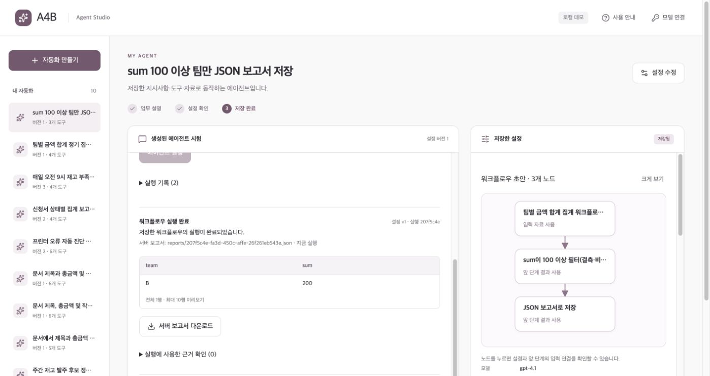
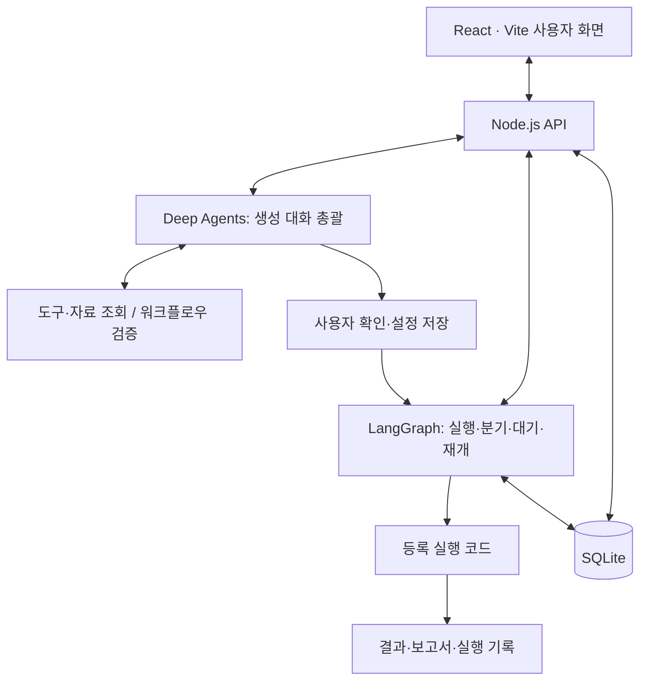

<div align="center">

# A4B

### 자연어 기반 AI 에이전트 업무 자동화 플랫폼

업무 설명을 실행 가능한 워크플로우로 연결합니다.

[빠른 시작](#빠른-시작) · [사용 예시](#사용-예시) · [구조](#시스템-구조) · [프로젝트 문서](#프로젝트-문서)

</div>

## 프로젝트 소개

A4B는 **업무 조건을 대화로 구체화하고, 처리 절차를 설계·저장·실행하는 플랫폼**입니다.

반복 업무를 맡길 때마다 대상과 처리 기준을 다시 설명하고, 필요한 도구와 실행 순서를 맞춰야 합니다. 조건이 달라지면 기존 설정도 다시 확인해야 합니다. A4B는 이 과정을 대화와 저장 가능한 워크플로우로 연결해, 확정한 업무 절차를 재사용할 수 있도록 지원합니다.

Deep Agents가 부족한 조건을 질문하고 도구·단계·설정을 구성합니다. 사용자는 생성된 흐름을 확인하고 저장한 뒤 실제 자료로 실행합니다. 이후 조건이 바뀌면 기존 흐름을 바탕으로 수정할 수 있습니다.


## 주요 기능

| 기능 | 제공하는 경험 |
| --- | --- |
| **대화형 업무 설계** | 전체 대화와 자료를 바탕으로 부족한 조건을 질문하고 실행 흐름을 구성합니다. |
| **워크플로우 확인·수정** | 캔버스에서 노드·연결·설정을 확인하고, 대화로 조건과 처리 단계를 수정합니다. |
| **노드·워크플로우 재사용** | 역할과 처리 규칙을 버전으로 저장하고, 저장된 흐름을 다른 흐름의 단계로 사용합니다. |
| **실제 자료 처리** | 필터·정렬·건수·합계, 정보 추출·근거 기반 답변, 결과 파일 생성을 연결합니다. |
| **사람이 확인하는 실행** | 실행 중 응답을 기다렸다가 재개하고, 응대 검수 결과는 운영자가 수정·승인합니다. |
| **예약·실행 기록** | 관리 표 자료의 정기 실행, 결과 보고서, 단계 기록과 실패 재시도를 제공합니다. |

> 생성된 캔버스는 흐름과 설정을 확인하는 화면입니다. 노드 이동·연결선의 직접 편집은 지원하지 않으며, 흐름 변경은 설계 대화로 요청합니다.

## 사용 흐름

| 화면 | 하는 일 |
| --- | --- |
| **노드 만들기** | 재사용할 에이전트 역할이나 처리 규칙을 저장합니다. 필요에 따라 사용합니다. |
| **워크플로우 설계** | 업무를 설명하고 자료를 연결합니다. 질문에 답하고 생성된 흐름을 확인·저장합니다. |
| **서비스 실행** | 요청과 자료를 넣어 저장한 흐름을 실행하고 결과·파일·처리 기록을 확인합니다. |

업무 설명으로 바로 설계할 수 있습니다. 사용할 노드를 직접 선택한 경우에는 해당 노드를 포함해 설계합니다. 저장된 노드는 버전으로 관리되므로, 노드를 수정해도 기존 워크플로우가 참조하는 버전은 유지됩니다.

## 빠른 시작

### 1. 준비 환경

- **Node.js 24 권장**: 패키지의 최소 요구 버전은 22.13.0입니다.
- **Python 3.12 권장**: 설치 스크립트가 3.11~3.14 인터프리터를 지원합니다.
- Git 및 최초 의존성 설치를 위한 인터넷 연결
- 생성 대화와 AI 처리에 사용할 OpenAI API 계정

### 2. 설치·실행

macOS 터미널과 Windows PowerShell에서 같은 명령을 사용합니다.

```bash
git clone https://github.com/20260528-skn-family-ai-33/SKN33-Final-5Team.git
cd SKN33-Final-5Team

npm --prefix Frontend ci
npm --prefix Frontend run setup
npm --prefix Frontend run dev
```

브라우저에서 **[http://127.0.0.1:3030](http://127.0.0.1:3030)**에 접속합니다. 서버 터미널을 유지하고, 종료할 때는 `Ctrl+C`를 누릅니다.

`run setup`은 Python을 찾아 `Backend/.venv-agent`를 만들고 잠금 파일의 의존성을 설치합니다. 상세 환경 설정은 [설치·환경 설정](#설치환경-설정)을 참고하세요.

### 3. 모델 연결

화면의 **모델 연결**에서 API 계정을 등록하고, 워크플로우 설계에 사용할 계정·모델을 선택합니다. 기본 모델은 `gpt-4.1-mini`입니다. API 키는 대화창이나 소스 코드에 입력하지 않습니다.

설계와 모델 기반 노드는 API를 호출합니다. 표 읽기·필터·집계·파일 저장 같은 등록 연산 자체는 모델을 호출하지 않습니다.

## 사용 예시

### 팀별 실적 보고서 설계와 수정

아래 합성 데이터를 UTF-8 형식의 `team-sales.csv` 파일로 저장한 뒤, **워크플로우 설계** 화면에 업로드합니다.

```csv
team,amount
A,0.1
A,0.2
B,120
B,80
```

**업무 설명**

> 연결한 매출 자료로 팀별 실적 보고서를 만들고 싶어.

필요한 기준을 확인하는 질문에 답해 집계 방식과 출력을 정합니다. 질문 내용은 실제 모델의 판단에 따라 달라집니다.

**조건 구체화**

> team별로 amount를 합계 집계해서 CSV로 저장해줘. 모든 행을 포함하고, 빈 금액이나 숫자가 아닌 값은 실패로 처리해줘. 정렬과 예약은 필요 없어.

초안에서 집계 열·그룹 기준·출력을 확인하고 저장한 뒤 **서비스 실행**에서 실행합니다. 위 데이터의 기대 결과는 다음과 같습니다.

| team | sum |
| --- | ---: |
| A | 0.3 |
| B | 200 |

**대화로 수정**

> 집계 결과에서 합계가 100 이상인 팀만 남기고 JSON으로 저장해줘. 나머지 조건은 유지해줘.

수정한 설정을 저장하고 같은 자료로 다시 실행하면 B팀의 합계 200만 남아야 합니다. 실제 생성된 노드와 연결은 캔버스에서 확인합니다.

### 다른 적용 사례

아래 업무를 구성하려면 각 항목에 필요한 자료를 준비해 연결합니다.

| 업무 | 구성할 수 있는 흐름 | 준비할 자료 |
| --- | --- | --- |
| 재고 점검 | 재고와 기준 수량 비교 → 부족 상품 보고서 → 예약 실행 | 상품별 재고와 기준 수량이 있는 표 |
| 정책 기반 응대 검수 | 정책·고객 문의·초안 조회 → 검수 보고서 → 사람 수정·승인 | 정책 문서, 고객 문의, 응대 초안 |
| 정보 추출·근거 답변 | 자료 읽기 → 필요 구간 검색·항목 추출 또는 답변 → 결과 출력 | 근거로 사용할 TXT·MD 또는 텍스트 PDF 문서 |

응대 검수의 실행 성공과 사람의 승인 완료는 별도 상태입니다. 최종 응대는 운영자 승인 후 내보내며, 외부 발송은 수행하지 않습니다.

<details>
<summary>저장소에 포함된 실행·노드 연결 화면 보기</summary>



2026-10-13에 기록한 실행 예시입니다. 현재 화면의 배치·문구와 일부 차이가 있을 수 있습니다.

</details>

## 시스템 구조



| 구성 | 실제 역할 |
| --- | --- |
| **Deep Agents** | 부족한 업무 조건 판단·질문·답변 반영, 도구 선택, 워크플로우 설계·수정을 담당합니다. |
| **검증 코드** | 스키마·자료·근거·노드 연결을 검사하고 오류를 돌려줍니다. |
| **LangGraph** | 생성 단계의 상태·대기·저장과 저장된 워크플로우의 실행·분기·재개를 관리합니다. |
| **등록 실행 코드** | 파일 읽기·필터·집계·추출·출력 등 실제 처리를 수행합니다. |
| **Node.js API·SQLite** | 업로드·계정 연결·worker 호출 및 설정 버전·체크포인트·실행 기록을 관리합니다. |

생성 대화는 별도 질문 모델을 앞에 두지 않고 Deep Agents가 총괄합니다. `list_tools`, `inspect_resource`, `validate_workflow`로 도구·자료·연결을 확인합니다. 업무 수행 시에는 저장된 흐름에 따라 등록 코드를 호출하며, 필요한 AI 노드에서 모델을 사용합니다.

### Tool · Node · Workflow

- **Tool**: 실제 처리를 수행하는 등록 기능입니다. 예: `aggregate_table`.
- **Node**: 도구에 업무별 설정과 입력 연결을 지정한 단계입니다. 예: `team`별 `amount` 합계.
- **Workflow**: 노드의 실행 순서와 데이터 연결을 저장한 업무 절차입니다.

워크플로우는 노드별 설정, 입력 연결인 `bindings`, 실행 경로인 `edges`로 구성됩니다. 새 업무마다 임의의 실행 코드를 생성하는 방식이 아닙니다.

세부 구현은 [워크플로우 데이터 모델](Backend/agent_builder/models.py), [노드·연결 검증](Backend/agent_builder/workflow.py), [설계 대화](Backend/agent_builder/nodes/conversation.py), [워크플로우 실행](Backend/agent_builder/workflow_runtime.py)에서 확인할 수 있습니다.

## 기술 스택

| 영역 | 기술 | 사용 목적 |
| --- | --- | --- |
| 사용자 화면 | React 19 · TypeScript · Vite | 설계 대화, 캔버스, 실행·승인 화면 |
| API 서버 | Node.js | 자료 업로드, 모델 계정, Python worker·예약 작업 관리 |
| 에이전트 | Deep Agents · LangChain OpenAI | 생성 대화와 모델·조회 도구 실행 |
| 흐름 제어 | LangGraph · SQLite Checkpointer | 상태, 분기, 사람 대기·재개, 체크포인트 |
| 실행·검증 | Python · Pydantic | 노드 실행과 설정·자료 계약 검증 |
| 저장 | SQLite · 로컬 파일 | 설정 버전, 실행·승인 기록, 업로드, 보고서 |
| 문서 처리 | Docling(선택) | PDF 문서 변환 |
| 자동 검사 | pytest · Node.js Test Runner · TypeScript | Python·서버 회귀 검사와 타입 검사 |

정확한 패키지 버전은 [Frontend/package-lock.json](Frontend/package-lock.json)과 [Backend/requirements-agent-lock.txt](Backend/requirements-agent-lock.txt)을 기준으로 합니다.

## 설치·환경 설정

선택 설정이 필요하면 `Frontend/.env.example`을 `Frontend/.env`로 복사합니다. `dev`와 `start` 명령이 해당 파일을 읽습니다.

| 설정 | 기본값·용도 |
| --- | --- |
| `HOST` | `127.0.0.1` |
| `PORT` | `3030` |
| `EASYFLOW_DATA_DIR` | 저장소 루트의 `data/`. 상대 경로도 저장소 루트 기준입니다. |
| `A4B_SETUP_PYTHON` | 설치에 사용할 Python 실행 파일을 지정할 때 사용합니다. |
| `A4B_AGENT_PYTHON` | 실행 worker의 Python 경로를 별도로 지정할 때 사용합니다. |
| `EASYFLOW_DOCLING_PYTHON` | 별도 Docling Python 환경을 지정할 때 사용합니다. |

**PDF 변환 환경 설치**

```bash
npm --prefix Frontend run setup:docling
```

표 처리 시연에는 필요하지 않습니다. 텍스트 PDF를 대상으로 하며 스캔 OCR는 현재 지원 범위에 포함하지 않습니다.

**간편 실행**

```bash
npm --prefix Frontend run demo
```

실행 중인 서버가 있으면 브라우저를 열고, 없으면 필요한 설치와 빌드 후 시작합니다. macOS는 `Frontend/scripts/실행.command`, Windows는 `Frontend/scripts/실행.cmd`로도 실행할 수 있습니다.

## 지원 범위

| 구분 | 현재 지원 |
| --- | --- |
| 표 입력 | CSV, XLSX, 객체 행 배열 형식의 JSON |
| 문서 입력 | UTF-8 TXT·MD, 텍스트 PDF |
| 파일 출력 | CSV·JSON, 텍스트 답변의 Markdown 출력 |
| 실행 제어 | 순차 연결, 조건 분기, 사람 응답 대기·재개 |
| 재사용 | 노드 버전 및 저장된 워크플로우의 특정 버전 |
| 예약 | 관리 표 자료의 일간·주간 실행 |

- 파일은 최대 8MB입니다. 문서 검색은 현재 단어 기반이며 의미 검색은 지원하지 않습니다.
- 병렬 실행·순환 반복, 임의 코드 실행, 등록 연동이 없는 외부 서비스 전송은 지원하지 않습니다.
- 예약은 서버가 실행 중일 때 동작합니다. 원본 PC 파일의 변경을 자동 감시하지 않으며 갱신 자료를 등록해야 합니다.
- 실행 실패를 Deep Agents가 자동 수정·재실행하는 기능은 아직 포함하지 않습니다. 기존 실패 기록에서 재시도할 수 있습니다.

현재는 로컬 개발 환경을 중심으로 구현했습니다. 다중 사용자 인증·권한, 운영 배포와 실제 사용자 환경의 시간 절감 효과는 별도 검증 대상입니다.

## 개발·검증

저장소 루트에서 실행합니다.

```bash
npm --prefix Frontend run test:python
npm --prefix Frontend run check
npm --prefix Frontend test
```

## 디렉터리

주요 소스와 문서의 구조입니다.

```text
.
├── Backend/
│   ├── agent_builder/      # 생성 대화·검증·실행·예약·승인·테스트
│   ├── integrations/
│   │   └── workflow_preprocessing/  # 전처리 코드·제안 명세
│   ├── scripts/            # Python 환경·문서 worker·데이터 도구
│   ├── requirements-agent.txt
│   └── requirements-agent-lock.txt
├── Frontend/
│   ├── app/               # 사용자 화면
│   ├── components/        # 화면 구성 요소
│   ├── hooks/             # React 훅
│   ├── lib/               # 공통 타입·유틸리티·카탈로그
│   ├── public/            # 아이콘 등 정적 파일
│   ├── scripts/           # 설치·시작·검증 명령
│   ├── server/            # API·계정·worker·예약 관리·테스트
│   ├── vendor/            # 외부 스타일시트·라이선스
│   ├── .env.example       # 환경변수 예시
│   └── package.json       # 패키지·실행 스크립트
├── docs/                  # 프로젝트 PDF 산출물 4개
├── images/                # 기록된 화면 이미지
├── Dockerfile
└── README.md
```

설치·실행 과정에서 생성되는 Python 가상환경, `node_modules/`, `Frontend/dist-app/`, `Frontend/build-server/`와 기본 데이터 폴더 `data/`는 Git 추적 대상에서 제외됩니다.

## 프로젝트 문서

`docs/`에 포함된 PDF 산출물입니다.

- [요구사항 정의서(초안)](<docs/1. 요구사항 정의서(초안).pdf>)
- [WBS(초안)](<docs/2. WBS(초안).pdf>)
- [프로젝트 기획서](docs/3.프로젝트_기획서.pdf)
- [수집 데이터 보고서](docs/4.수집_데이터_보고서.pdf)
