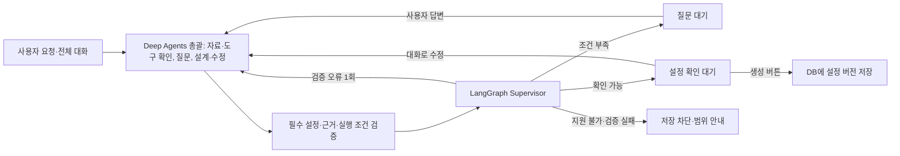

# A4B 단일 에이전트 생성 데모

사용자가 업무 상황을 설명하면 필요한 정보를 확인하고, 모델·지시사항·도구·자료·실행 조건을 연결한 에이전트를 생성합니다. 생성한 에이전트를 시험하는 버튼은 생성 결과가 실제로 동작하는지 확인하기 위한 기능입니다.

## 생성 흐름

대화 노드는 `create_deep_agent`를 실제로 사용합니다. Supervisor는 이번 단일 기능에 필요한 규칙 기반 라우터입니다. 여러 LLM 역할을 추가하는 `langgraph-supervisor` 패키지는 사용하지 않습니다. 추가 질문·사용자 확인에는 LangGraph `interrupt`와 `Command(resume=...)`를 사용하고 공식 `SqliteSaver`로 상태를 보존합니다. Deep Agents도 내부적으로 LangGraph 위에서 실행됩니다.

## 기존 데모에서 재사용

- React·Vite, 대화 옆 설정 패널과 기존 Dialog 컴포넌트.
- OpenAI 연결 계정 및 AES-256-GCM 암호화 저장소. 새 Python DB에 API 키를 복사하지 않습니다.
- 검증된 CSV 파서, 별도 worker의 Excel 읽기, 텍스트 PDF 추출.
- 기존 워크플로우 실행 엔진 코드는 보존합니다. 기본 화면에는 캔버스·템플릿·예약·다수 커넥터 메뉴를 노출하지 않고 기본 시작에서는 과거 예약 작업을 자동 실행하지 않습니다.

## 코드와 DB 분리

각 단계의 코드는 `Backend/agent_builder/nodes/*.py`입니다. 업무 도구 구현은 `tools/read_table.py`, `tools/filter_sort.py`, `tools/write_result.py`입니다. 에이전트마다 코드를 생성하는 방식이 아니라 등록된 코드와 검증된 실행 설정을 조합합니다.

| 테이블 | 저장 내용 |
|---|---|
| registered_tools | 도구 ID·버전·설명·입력 명세·코드 모듈 경로 |
| builder_sessions | 모델·계정 참조·자료 ID·대화 버전 |
| builder_assets | 원본 해시·열·예외 통계·읽은 원본 행·규칙 문서 본문 |
| agent_versions | 이름·지시사항·도구·자료·처리 조건·도구 버전의 변경 불가능한 버전 |
| agent_tests | 시험 요청·설정 스냅샷·실제 도구 인자·결과·오류 |
| checkpoints 및 관련 표 | 공식 LangGraph 체크포인트와 질문·확인 대기 상태 |

현재 DB는 로컬 SQLite입니다. Django/DRF·MySQL로의 전환 및 기업별 인증·권한 관리는 이번 기능 데모에 구현하지 않았습니다.

## 실행 조건을 보존하는 방법

LLM이 지시사항과 구조화된 `execution_plan`을 함께 생성합니다. 생성 화면에 실제 필터·숫자 정렬·중복·결측·출력 조건을 표시하고 사용자가 확인합니다. 시험 도구는 저장된 계획 그대로 실행하므로 실행 중 LLM이 임의로 인자를 바꿀 수 없습니다. 첫/마지막 중복 행은 정렬 후가 아닌 원본 순서 기준입니다.

결과 파일이 만들어졌다는 상태는 도구에서 실제 파일이 생성됐다는 의미입니다. 모든 업무 의도를 자동으로 정답 판정했다는 의미는 아닙니다. 원문 인용의 존재·필드·도구·처리 인자는 검사하지만 사용자 의도와 생성 설정의 모든 의미적 일치를 보장하지는 않습니다.

## 지원 범위

CSV·XLSX·JSON 표 파일과 TXT·MD·텍스트 PDF 규칙 자료. 표 읽기, 값/열 비교, 여러 필터, 숫자/문자 정렬, 중복/결측 처리, CSV/JSON 결과. 이미지 OCR·복잡한 문서 RAG·외부 전송·예약·커넥터 추가·자체 ML 분류는 이번 데모 범위 밖입니다.

## 2026-10-14 총괄 역할 수정

생성 대화의 별도 DesignIntent·BusinessQuestions·DraftReview 모델 호출을 제거했습니다. Deep Agents가 대화 전체와 현재 초안, 검증 오류를 받아 직접 부족한 조건을 질문하고 답변을 반영해 설계·수정합니다. `list_tools`, `inspect_resource`, `validate_workflow`는 총괄 에이전트의 도구입니다. 질문·미지원 상태는 workflow=null로 대기할 수 있습니다. 코드 검증은 고정 질문을 만들지 않고 오류를 반환하며, LangGraph는 같은 대화 노드로 수정 요청을 전달하거나 사용자 입력·승인을 기다립니다. 실제 파일 처리와 저장은 기존 실행 코드가 담당합니다. 실행 실패를 자동 복구해 재실행하는 에이전트 루프는 이번 범위에 포함하지 않습니다.
