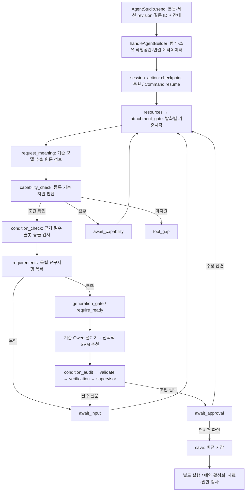

# A4B 되묻기 시스템 점검 및 개선 보고서

점검일: 2026-11-10 (Asia/Seoul). 대상: `SKN33-Final-5Team`, 브랜치 `codex/gmail-connection-setup-ux-20261110`, HEAD `525f66325a14f8d3995ad0cb57277e5a6f4f23ed`.

**기존 Qwen·도구 추천·LangGraph·검증·저장 경로를 유지하면서 재현된 제어 오류를 수정했다. 추가 모델은 도입하지 않았다. 실제 Qwen 품질과 운영 배포 완료를 의미하지 않는다.**

## 1. 기준 상태와 검증 범위

작업 시작 당시 이미 Gmail 의미 추출, 시간 맥락, 사용자용 초안 설명 등에 미커밋 변경이 있었다. 이번 비교 기준은 순수 HEAD가 아니라 **그 변경을 포함한 작업 시작 시점의 소스**다. 기존 변경을 되돌리지 않았다. 특히 `request_meaning.py`, `temporal_context.py`, `test_meaning_graph.py`, `test_request_meaning.py`, `test_public_draft_summary.py`, `test_temporal_context.py`, 의미 fixture 및 live 실행기는 작업 전에 존재했다.

실제 Gmail 메일, 고객 자료, OAuth 토큰, 외부 발송을 사용하지 않았다. 모델 transport에는 합성 JSON을 주입했다. 로컬 저장·표 계산·파일 출력은 합성 자료로 실제 실행했다. UI는 컴포넌트 함수와 API 계약을 검사했으며 실행 중인 브라우저를 관찰하지 않았다.

현재 프로세스와 루트 `.env` 적용 결과 `A4B_MAIN_PROVIDER`, `A4B_MAIN_BASE_URL`, 세 가지 검사 MODE가 모두 미설정이었다. 승인된 운영 모델 endpoint가 이 작업 환경에 구성되어 있지 않아 RunPod/Qwen 원본 응답과 실제 모델 지연은 수집하지 않았다. 운영 환경의 설정까지 미설정이라는 뜻은 아니다.

## 2. 현재 아키텍처와 실제 데이터 흐름



대표 함수와 책임은 다음과 같다. 경로는 저장소 루트 기준이다.

| 구간 | 파일 / 함수 | 확인한 동작 |
|---|---|---|
| Frontend 입력 | `Frontend/app/agent-studio.tsx`: `ensureSession`, `send`, `remember` (154, 155, 146행) | 서버 세션 ID, revision, 본문, 선택한 questionId를 전송. 이번에 브라우저 IANA 시간대를 추가. 결과 전체를 서버 응답으로 교체 |
| 화면 질문 | 같은 파일의 `session.messages.map` (389행 이후), `draft.questions` 선택지 | assistant 본문을 대화에 표시하고 `pending_questions[i].id`로 선택 답변을 연결 |
| HTTP 경계 | `Backend/api/src/agent-builder.ts`: `handleAgentBuilder` (194행), `builderWorker`, `runBuilderWorker` | 길이·ID·revision 검증, 작업공간·락, Python worker 호출. Gmail 연결 여부는 서버 Store에서 선택하고 클라이언트 토큰을 전달하지 않음 |
| 상태 복원 | `Backend/service/handlers/design.py`: `public_state` (19행), `_session_action` (78행) | `session.id == configurable.thread_id`; 전체 messages·자료·초안 복원. interrupt면 `Command(resume=...)`, 오류 뒤 재시작도 상태 유지 |
| 영속화 | `Backend/infrastructure/persistence/checkpoints.py`: `checkpoint_connection`, `checkpointer` | SQLite에서는 업무 DB와 같은 파일, PostgreSQL에서는 workspace로 구분한 checkpoint 연결. 이번 재시작 검증은 SQLite |
| 의미 추출 | `Backend/agent_builder/design/request_meaning.py`: `make_meaning_node` (221행), `extract_meaning`, `sealed_meaning`, `gmail_selection` | 기존 Qwen으로 구조화 추출 후 별도 원문 충실도 검토. digest/fingerprint로 묶음. 현재 서비스 어댑터는 Gmail 중심이며 실패 시 원문을 일반 설계기로 넘김 |
| 지원 판단 | `Backend/agent_builder/capabilities/capability_judgement.py`: `assess_capability` (323행); `capability_check.py`: `make_capability_check` (43행) | 실제 카탈로그와 모델 제안을 대조. `existing_tools/clarify/missing_capability/manual_review`, 별도 `system_error`. 지원됨은 최종 READY 허가가 아님 |
| 조건 검증 | `Backend/agent_builder/conditions/condition_readiness.py`: `validate_conditions` (972행); `condition_check.py`: `make_condition_check` | 단일 표의 필수 슬롯, 원문 근거, 숫자, 예약, 명시 정책, 충돌·보류 처리. 범위 밖 작업은 일반 설계 경로로 넘김 |
| 독립 요구사항 | `Backend/agent_builder/design/requirement_ledger.py`: `make_requirement_check` (269행), `extract_plan`, `validate_plan` | 사용자 요구를 생성 초안과 별도로 추출. 기존 조건·질문 맥락·전체 대화를 전달하고 미해결 조건은 이번에 interrupt로 연결 |
| ML 추천 | `Backend/ml/advice/tool_recommendation.py`: `recommend_for_state`; `Backend/ml/svm56/svm56_service_hook.py`: `recommend_svm_for_state` (38행); `request_context.py`: `request_context` | 요청/대화 맥락, 자료 종류·열 등을 추천 입력으로 구성. `ml_candidates`, 상태, advisory metadata를 planner에 전달. SVM 추천은 전체 등록 카탈로그를 대체하거나 READY를 결정하지 않음. 실패 시 추천 없이 진행 |
| Qwen 생성 | `Backend/agent_builder/design/nodes/conversation.py`: `make_conversation` (122행); `direct_conversation.py`: `make_direct_conversation` (357행), `OllamaPlanner` | Deep Agent 기본 경로 또는 Ollama direct. 전체 대화, 자료, 확정 조건, 시간 맥락, 생성 스키마, 추천을 전달. JSON/Pydantic 정규화와 제한된 재시도 |
| 모델 연결 | `Backend/infrastructure/llm/model_factory.py`: `create_chat_model`; `requirement_ledger.py`: `requirement_transport` | openai/ollama/vllm 구성 재사용. Ollama direct는 `/api/chat`, JSON schema, think=false, seed=42, 기본 context 16384와 환경 설정을 사용. vLLM 공통 경로는 구조화 출력·thinking 비활성화, temperature 0.7/top_p 0.8 등의 기존 설정 유지 |
| 검증/종료 | `Backend/agent_builder/design/graph.py`: `build_graph` (53행); `nodes/validation.py`: `validate_node`; `nodes/supervisor.py`: `supervisor_node` | 입력/요구사항·workflow 포트와 참조·근거·도구 검증. 남은 질문은 대기, 검증 오류는 제한된 repair, 최종 초안은 승인 대기 |
| 저장 | `Backend/agent_builder/capabilities/capability_gate.py`: `require_ready`, `require_save_ready`; `nodes/save.py`: `make_save_node` | 미해결·오래된 요구사항으로 생성 우회 금지. 최종 요구사항 반영·조건·검증 결과·사용자 확인 검사 후 기존 버전 저장 |

### A–H 확인 결과

| 항목 | 확인 결과 |
|---|---|
| A. 기존 sLLM/분류/라우터/Middleware | 이미 Qwen 연결, SVM 추천, capability·condition·requirement 검사와 LangGraph router가 있다. `design/request_judgement.py`는 실험용 facade이며 서비스 gate가 아니다. `conditions/clarification_contract.py`의 대문자 분류는 인계 규격이며 현재 HTTP 서비스 전체를 단독 제어하지 않는다 |
| B. Qwen이 필요 여부와 질문을 모두 결정하는가 | 일반 capability와 planner에서는 상당 부분 그렇다. 단일 표 조건에서는 코드가 missing 슬롯과 질문을 만든다. Gmail의 검증된 계약에는 코드 경로가 있다. 따라서 모든 질문이 한 프롬프트에서 결정되는 구조는 아니다 |
| C. 이전 조건 전달 | 전체 messages는 복원되지만 요구사항 추출 payload에는 사용자 발화 목록만 있었고 질문과 답변의 연결 정보가 빠졌다. 이번에 conversation·pending_questions·이전 요구사항을 추가했다 |
| D. 누락과 미지원 | 카탈로그 판단 계약과 별도 system_error가 존재한다. 다만 requirement unresolved가 system failure로 처리되던 오류를 재현·수정했다. 모델이 분류 자체를 잘못하는 빈도는 미측정 |
| E. 날짜/개수 재질문 | 작업 시작 때 이미 Gmail 의미·날짜 수정이 존재했다. 현재 fixture에서 최근 5건과 어제는 재질문 없이 생성된다. 브라우저 시간대는 API로 전송되지 않아 한국 기본값을 쓰던 경로를 이번에 수정. 지난주 로컬 경계도 추가 |
| F. 내부 문장 노출 | 기존 작업본의 `public_draft_explanation`이 모델 설명을 등록 작업 설명으로 교체한다. 사용자 사례 A의 문구는 설명용 고정 템플릿과 관련 있다. 이번에는 requirement 예외 원문이 사용자 messages/trace에 노출되는 것을 재현·제거하고 planner timing log의 파싱 예외 원문도 제거 |
| G. CLARIFY 상태 유지 | capability/condition interrupt는 이미 존재. requirement에는 없었음. 이번에 부분 ledger와 질문을 유지한 interrupt/resume을 추가하고 재시작·질문 ID·저장까지 검증 |
| H. FE/BE 이중 상태 | FE는 서버 snapshot과 임시 입력을 보유하고 localStorage에는 세션 ID를 저장한다. 별도 의미 ledger를 FE에서 생성하는 구조는 확인되지 않았다. revision 및 지연 응답 방어가 존재. 질문 여러 개를 1개로 합친 capability UI projection은 답변 인덱스 대응을 훼손할 수 있어 제거 |

## 3. 재현한 오류와 수정

| 원인 | 수정 전 확인 | 수정 |
|---|---|---|
| 업무상 누락을 예외로 처리 | `make_requirement_check`: `plan['unresolved']`이면 ValueError → `validation_failed`/stop. 3개 요청과 실제 그래프 재시작 테스트 실패 | `_clarification`이 부분 ledger·미해결 목록을 보존하고 구체적인 질문 1~2개를 생성. requirements → await_input 분기 추가 |
| 질문 맥락 누락 | 추출기에 conversation/pending_questions/previous_requirements가 없다는 assertion 실패 | 전체 대화와 이전 후보 전달. 최신 답변 우선·나머지 조건 유지. 이전 후보는 사용자 원문보다 우선하지 않도록 명시 |
| 안전한 재개 경계 부족 | 새 requirement 질문 source를 await_input이 처리할 수 없고 미해결 ledger로 직접 planner 재개할 위험 | requirement source의 ID 검증·재개 추가, cache에서도 unresolved는 대기. `require_ready`에서 업무 목록·fingerprint·digest·미해결 여부 확인 |
| 모호한 요청에도 task 강제 | RequirementPlan tasks 최소 1개로 인해 아무 업무 설정도 확정 못한 경우 질문만 표현 불가 | tasks=[] + 구체적 unresolved 허용. 둘 다 비어 있는 응답은 실패 유지 |
| 질문 과다/ID 대응 | capability 질문 4개가 전달됨. 3번째 UI 질문에 여러 질문을 합침 | 현재 노출 질문과 질문 ID를 1:1로 일치시켜 2개만 표시. 나머지는 assessment에 보존. 표 조건도 2개씩 재계산 |
| provider 강제 | `A4B_MAIN_PROVIDER=vllm`인데 capability가 OllamaPlanner를 생성하여 system_error. 별도 실패 XML 보관 | 기존 `requirement_transport`/공통 model factory 재사용, graph의 api_key 전달. 새 모델 또는 외부 API를 추가하지 않음 |
| 시간대 경로 단절 | BuilderState에는 user_timezone가 있지만 FE와 API에서 공급하지 않음 | optional `userTimezone` → 검증 → worker의 `user_timezone` → graph checkpoint. 기존 클라이언트는 기본값 유지. 발화별 시각을 보존하고 지난주를 월요일 기준 로컬 자정으로 계산 |
| 예외 정보 노출 | 합성 secret가 포함된 ValueError가 사용자 메시지와 trace에 그대로 나타남 | 사용자용 고정 오류 + error_type만 남김. 정상적인 업무 질문과 모델/계약 오류는 계속 구별 |
| 오래된 인계 fixture | Gmail `email.list`/`email.get`의 설명·출력 포트·operation fingerprint와 저장 fixture가 달라 17건 실패 | 현재 실제 카탈로그를 기준으로 합성 tool-catalog와 9개 입력 fingerprint 갱신. fingerprint 검사 자체는 유지 |

사례 A/B의 **운영 당시 원인을 완전히 확정한 것은 아니다.** 운영 모델 원본 응답과 배포 revision이 없고, 시작 시점에 이미 관련 수정이 존재했다. 현재 작업본에서는 동일 요청과 변형 문장을 mock 의미 추출 및 실제 그래프로 검증했다. 일반 문장의 해석 실패율이나 반복 질문 전체가 해결됐다고 주장하지 않는다.

## 4. 대화 상태와 되묻기 정책

새 병렬 세션 저장소를 만들지 않고 기존 BuilderState를 사용한다.

- 의도/선택 조건: 기존 `request_meaning`과 원문 검토 seal.
- 확정/미확정 조건: `condition_ledger.slots`의 status·value·evidence, `requirement_ledger.tasks/unresolved`.
- 질문: `pending_questions`의 id/key/source/text/options. 화면에 보이는 질문과 ID를 동일한 순서로 보존한다.
- 답변: 기존 messages, condition_answers, capability_answers. requirement 답변은 전체 대화와 이전 ledger를 다음 추출에 함께 공급한다.
- 충돌/수정: 표는 코드의 원문·근거 검증, 일반 업무는 최신 발화 기반 재추출 후 원문·workflow coverage 검사. 출처가 없는 값을 코드가 확인값으로 승격시키지 않는다.
- 시간: `temporal_context`와 user_message_anchors. 다음날 답해도 원래 어제의 기준시각 유지. v1 checkpoint는 원래 시각으로 v2 주간 맥락을 보완한다.
- 종료: unresolved가 없어야 생성 가능. 생성 결과 검사 후 기존 승인 대기. 생성 완료와 저장·실행 완료는 구별한다.

기본값은 사용자 결정과 구별한다. 기존 Gmail 기간 조회의 최대 100건, 앱 기본 시간대 Asia/Seoul 등은 기존 정책이며 명시한 개수를 덮어쓰지 않는다. 시간대 기본값이 있다고 미정 예약 주기·시각·수신 주소를 생성하지 않는다. 계정 연결 여부는 설계 가능 여부와 별개이며 토큰 유효성·실제 권한은 서버의 실행/활성화 경계에서 검사한다.

일반 planner 자체의 최대 3개 질문 계약은 호환성을 위해 유지했다. capability·표 조건·새 requirement 질문 단계는 2개씩 표시한다. 모든 자연어 질문의 필요성을 규칙만으로 증명하는 범용 슬롯 엔진을 새로 만들지는 않았다.

## 5. 동일 데이터 전후 비교

사례별 요청, 이전 대화, 추출 결과, 선택 도구, 기대/실제 분류, 필요한 질문 이유, 합성 모델 응답, 사용자 메시지 projection과 실패 원인은 다음 파일에 있다.

- [수정 전 10개 사례](clarification-corpus-before.json)
- [수정 후 동일 10개 사례](clarification-corpus-after.json)
- [최초 7개 실패 테스트](clarification-before.xml)
- [provider 오류 수정 전 재현](clarification-provider-before.xml)
- [최종 Python 회귀 결과](clarification-regression.xml)
- [Frontend/API 회귀 결과](clarification-typescript-tests.tap)

10개는 최근 5개 Gmail, 어제 Gmail, 매일 9시 이메일 보고서, 고객 분석, 지난주 매출 이메일, 이전 주소 참조, 이미 준 조건, 답변 후 진행, 5→10개 수정, Slack 미지원이다. JSON의 `qwen_raw_response`는 null이고 `mock_response`에 합성 응답을 기록했다. `frontend_response_projection`은 서버 응답에서 화면이 소비하는 본문이며 실브라우저 관찰값이 아니다.

**아래 분류 지표는 단계별 routing fixture 정확도다.** capability의 existing_tools를 정규화한 READY는 그 단계의 통과를 뜻하며 저장 가능한 최종 workflow READY와 같지 않다. 모델 출력이 입력 fixture이므로 모델 의미 해석 정확도/F1로 인용하면 안 된다.

| 지표 | 수정 전 | 수정 후 | 해석 범위 |
|---|---:|---:|---|
| 단계 분기 정확도 | 7/10 (70%) | 10/10 (100%) | 합성 출력에 대한 제어 로직 |
| READY F1 | 1.00 | 1.00 | 위 fixture |
| CLARIFY F1 | 0.00 | 1.00 | 위 fixture |
| UNSUPPORTED F1 | 1.00 | 1.00 | 위 fixture |
| 필요한 질문 수행 | 0/3 | 3/3 | 미해결 requirement 3건 |
| 불필요한 질문 | 0/7 | 0/7 | 기대 질문 없음 7건 |
| 동일 조건 재질문 | 0/1 | 0/1 | 이미 정한 Gmail 개수 probe 1건만 |
| 답변 반영 | 모델 의미 정확도 미측정 | 실제 graph fixture 1/1 | 기존 금액 20 유지, JSON 답변, 원문 보존 검사 |
| 되묻기 완료 | 0/1 | 1/1 | 동일 restart/answer/approval 테스트 |
| 최종 workflow·실행 | 해당 신규 경로는 생성 전 종료, 실행 미실시 | 로컬 합성 표 1/1 성공 | qty×10, 20 이상, 내림차순, JSON 실제 저장·실행 |
| 평균 fixture 처리 시간 | 8.686ms | 7.441ms | 모델/HTTP 지연 제외. 반복 측정이 아니므로 속도 개선 결론 금지 |
| 실제 Qwen/외부 Gmail 실행 성공률 | 미측정 | 미측정 | 모델 endpoint 및 계정 자료를 사용하지 않음 |

최종 `tests/design tests/capabilities tests/conditions`: **1,871 passed, 43.45초**. 새 회귀 파일은 12개 사례이며 최초 7건과 추가 provider 1건을 수정 전에 실패로 확인했다. 나머지는 변경 경계 검증을 추가한 것이다. Frontend/API 41개 통과. Frontend와 Backend TypeScript `--noEmit` 검사 통과. CRLF를 정상 줄끝으로 지정한 `git diff --check` 통과.

첫 넓은 실행은 1,828 통과/42 실패였다. Windows cp949 읽기 실패를 UTF-8 실행으로 구분한 뒤, 남은 오래된 카탈로그 fixture와 변경된 질문 개수에 대한 기대값을 수정했다. 최초 실패 결과는 [초기 회귀 기록](clarification-regression-initial.xml)에 보존했다. 실패를 성공으로 덮어 적지 않았다.

시험 환경: Python 3.12.14, pytest 9.2.0, langgraph 1.2.19, pydantic 2.14.2, langgraph-checkpoint-sqlite 3.1.3. 작업공간의 기존 `pr56-test-deps`를 재사용했다. 운영 lock 설치 환경과 동일하다는 검증은 하지 않았다.

재실행 예시(저장소 개발 Python 의존성 준비 후):

```powershell
$env:PYTHONUTF8='1'
python scripts/verify/verify-clarification-audit.py --output docs/clarification-corpus-after.json
cd Backend
python -m pytest tests/design tests/capabilities tests/conditions -q --junitxml=../docs/clarification-regression.xml
cd ..
node --import tsx --test Backend/api/tests/request-timezone.test.ts Backend/api/tests/gmail-design-context.test.ts Frontend/tests/agent-studio-state.test.ts
node node_modules/typescript/bin/tsc -p Frontend --noEmit --incremental false
node node_modules/typescript/bin/tsc -p Backend/api --noEmit --incremental false
```

## 6. 이번 작업에서 수정·추가한 파일

다음은 이번 작업의 파일 목록이다. git status의 다른 변경은 시작 때 이미 있던 작업이 포함되어 있으므로 이번 성과로 합산하지 않는다.

| 종류 | 파일 |
|---|---|
| 지원 판단·생성 보호 | `Backend/agent_builder/capabilities/capability_check.py`, `capability_judgement.py`, `capability_gate.py` |
| 표 조건 정책 | `Backend/agent_builder/conditions/condition_readiness.py` |
| 요구사항·재개 | `Backend/agent_builder/design/requirement_ledger.py`, `requirement_contracts.py`, `graph.py`, `nodes/await_input.py` |
| 시간·로그 | `Backend/agent_builder/design/temporal_context.py`, `nodes/conversation.py` |
| API·worker·화면 | `Backend/api/src/request-timezone.ts`(신규), `Backend/api/src/agent-builder.ts`, `Backend/service/handlers/design.py`, `Frontend/app/agent-studio.tsx` |
| Python 테스트 | `Backend/tests/design/test_clarification_audit.py`(신규), `test_requirement_coverage.py`, `Backend/tests/capabilities/test_capability_gate.py`, `Backend/tests/conditions/test_condition_readiness.py` |
| TypeScript 테스트 | `Backend/api/tests/request-timezone.test.ts`(신규), `gmail-design-context.test.ts`, `Frontend/tests/agent-studio-state.test.ts` |
| 인계 명세 fixture | `Backend/tests/fixtures/clarification-handoff/tool-catalog.json`, `examples/01-ready.input.json`부터 `09-conflict.input.json`까지 9개 입력 |
| 재현·보고 | `scripts/verify/verify-clarification-audit.py`, 이 보고서, 위 7개 JSON/XML/TAP 결과 파일 |

## 7. 잔존 문제와 우선순위 / 추가 sLLM 판단

1. **P0: 운영 설정과 실제 Qwen 검증.** 검사 MODE의 코드 기본값은 off이고 기존 checkpoint의 강제 검사 표식은 유지된다. 이번 수정은 사용 중인 enforce 경로를 고쳤으며 기본값을 조용히 바꾸거나 운영 배포하지 않았다. 실제 서비스의 provider/model/MODE, 배포 소스 revision과 가중치를 확인한 뒤 동일 합성 코퍼스로 모델 원본 출력을 평가해야 한다. 현재 live 의미 추출 실행기는 Gmail 중심이므로 일반 보고서/발송까지 전체 live E2E 정확도를 제공하지 않는다.
2. **P1: 일반 업무의 필수 조건 검증 범위.** 표와 Gmail 외 업무에서는 모델이 누락 조건을 발견하고 의미를 병합하는 비중이 크다. `unresolved`를 잘못 비우거나 이미 답한 내용을 다시 내는 모델 오류까지 전부 해결한 것은 아니다. 등록 도구별 필수 인자/조건의 근거 대조를 확대하고, 실제 실패 발화를 추가해야 한다. 임의의 문장별 정규식 예외나 단어 하나만 보고 질문 삭제하는 방식은 추가하지 않았다.
3. **P1: 실제 모델 기준 장기 대화/이전 주소/변경의 의미 평가.** 이번에는 전체 맥락 전달·상태 복원·코드 조건 반영을 검사했다. 대명사 해석, 모호한 분석 목적, 최신 변경 우선의 실제 Qwen 정확도는 미측정이다. PostgreSQL 재개, 배포 브라우저, OAuth 만료·권한 변경도 실환경 검증 대상이다.
4. **P2: 성능.** 기존 의미 추출·검토는 최대 4회 호출할 수 있고 뒤의 capability/requirement/planner가 추가된다. 새 모델 호출 단계는 만들지 않았지만 상태 맥락 전송으로 입력 토큰이 늘 수 있다. 실제 p50/p95 지연과 반복 질문률을 수집한 뒤 캐시·호출 생략을 판단해야 한다. 생략 시 요청·자료·시간대 fingerprint를 유지해야 한다.

**추가 sLLM은 현재 제안하지 않는다.** 확인된 주요 오류는 provider 선택, 질문 분기, 상태/질문 맥락 전달, 시간대 전달, UI 질문 대응, 오류 노출이었다. 기존 Qwen과 코드 제어만으로 합성 분기 정확도가 70%→100%로 개선됐지만 이는 추가 모델 대비 실측 우위를 뜻하지 않는다. 새 모델은 동일한 실제 모델 평가 코퍼스에서 의미 해석·분류 F1·재질문률·완료율과 p95 비용/지연이 개선된다는 비교 결과가 있을 때만 검토하는 것이 타당하다.
